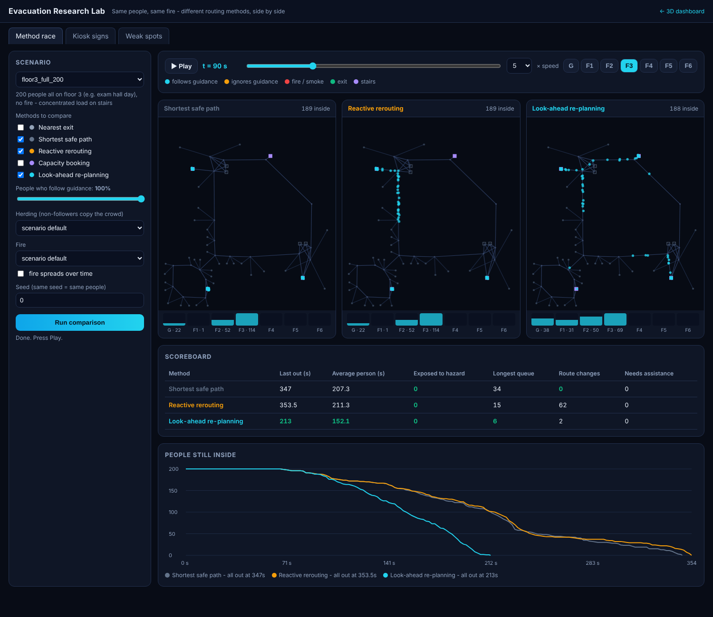

# Crowd-Aware Evacuation Planner

Capstone project (Team 212): plan indoor evacuations that account for crowds, fire and smoke, then test the plans on a seeded crowd simulator.

Most evacuation tools send everyone to their nearest exit. This project instead **books capacity on corridors, doors and stairs ahead of time** and re-plans every few seconds, so people spread across exits instead of jamming one stairwell, and stay out of smoke.



## Headline results

All numbers come from seeded simulations (campus: 10 scenarios x 6 methods x 30 paired seeds, 2,766 runs). Full tables: [docs/final_results.md](docs/final_results.md).

| Result | Number |
| --- | --- |
| Look-ahead planning vs shortest safe path | significantly faster in **8 of 10** campus scenarios (Holm-corrected Wilcoxon), slower in 0 |
| Best case (200 people on one floor) | last person out in **234 s instead of 367 s** |
| Spreading fire, 200 people on floor 3 | people exposed to smoke **109 -> 25** |
| Second building (100-bed hospital, 124 nodes) | faster walking-crowd evacuation in **6 of 6** scenarios |
| ML crossing-time error, held-out simulated data | **4.76 s -> 2.41 s** (784,014 crossings) |
| ML error on real crowd data (1,813 crossings, Juelich) | **2.12 s** (hybrid model) vs 7.16 s for pure ML |
| Planner speed | one re-plan for 2,000 people on the 452-node campus in **1.06 s** |

An honest finding: the gain comes from **coordination** (capacity booking), not from prediction accuracy. Better ML walk times changed results only slightly.

## What is in here

- **Seeded simulator** (`evac/`): people walk, queue at doors and stairs, have different speeds and delays (walkers, wheelchairs, beds), and fire and smoke can spread. Calibrated on real Juelich crowd experiments and checked against lab door-flow data and NIST stair-speed data ([docs/validation.md](docs/validation.md)).
- **Routing methods**: nearest exit, shortest safe path, reactive rerouting, one-shot capacity booking, look-ahead re-planning (A* search), plus a genetic algorithm (offline benchmark) and a max-flow lower bound.
- **Hybrid ML delay model**: LightGBM learns a correction on top of a physics formula for crossing times ([docs/ml_v3.md](docs/ml_v3.md)).
- **Two buildings** as JSON "building packs" (`buildings/`): a 6-floor campus (452 nodes) and an oncology hospital. Any floor plan can be added ([docs/BUILDING_GUIDE.md](docs/BUILDING_GUIDE.md)).
- **Two dashboards**: a 3D campus view that finds a fire-aware route with a time-to-exit estimate, and a Research Lab where methods race side by side with a live scoreboard, kiosk signs and weak-spot analysis.
- **Studies** (each with a report in `docs/`): safety vs speed, time-to-exit ranges on signs, vulnerable-first priority, scalability, secondary jams, unknown compliance, evacuation lifts.

```
building packs --> seeded simulator <-- real crowd data (calibration)
                        |  crossings
                        v
                 ML delay model --> planners (look-ahead capacity booking)
                                          |
                          experiments + stats        FastAPI --> 3D dashboard / Research Lab
```

## Run it

Python 3.10+.

```bash
pip install -r requirements.txt
python research_server.py
```

- http://localhost:8000/ : 3D dashboard (pick an origin room, add a fire, press "Find Evacuation Route")
- http://localhost:8000/research : Research Lab (pick a scenario and methods, run, press Play)

The 3D page loads three.js from a CDN, so it needs an internet connection.

### Reproduce the results

```bash
python -m evac.reproduce_all              # reuses finished runs in results/
python -m evac.reproduce_all --list       # steps and run times
python tests/test_evac_session1.py        # example test file (more in tests/)
```

A full run from scratch takes about 4 hours on a 2-core laptop. Details: [docs/REPRODUCE.md](docs/REPRODUCE.md). `results/` is git-ignored, so regenerated outputs stay local.

## Repo map

| Path | Contents |
| --- | --- |
| `evac/` | simulator, planners, ML model, experiments, studies, API |
| `docs/` | every study report, figures, validation and calibration notes |
| `buildings/` | campus and hospital building packs (JSON) |
| `models/` | trained models |
| `tests/` | checks per development phase |
| `index.html`, `research.html`, `server.py`, `research_server.py` | dashboards and server |
| `generate_dataset.py`, `train_model.py`, `ml_evacuation_router.py` | first-stage Random Forest router (still used by the 3D dashboard) |

## Limits

- Results are from simulation. The simulator is calibrated and cross-checked against real data, but no real building drill was run (a stopwatch protocol is in [docs/field_validation_protocol.md](docs/field_validation_protocol.md)).
- The first-stage Random Forest (test R2 0.98) fits the team's own cost formula, not real data.
- Very large towers exceed the 5 s re-plan budget ([docs/scalability.md](docs/scalability.md)).
- The real-data sample in `data/juelich/` comes from the Juelich data archive. Check its licence and citation before reusing it.


