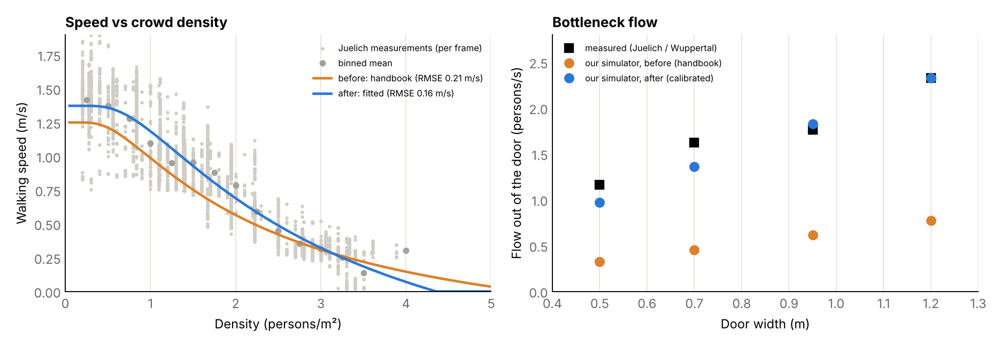

# Calibration on real crowd experiments (Improving ML, step 2)

The simulator's walking speed, speed-density curve and door flow were set from handbooks. Here they are **fitted to real trajectories** recorded by Forschungszentrum Juelich (one-way corridor and bottleneck experiments; `data/juelich/`, see `evac/calibration.py`).

## Findings

1. **Speed vs density** (14,838 per-frame measurements, 12 corridor runs): fitted free speed 1.37 m/s (was 1.25), jam density 4.35 persons/m² (was 5.4), shape 2.58 (was 1.913). Error of the curve: 0.21 -> 0.16 m/s.
2. **Door flow**: fitted 1.93 persons/s per metre of door width (was 1.3, the SFPE design value). Corridors carry up to 1.41 persons/s/m (the capacity of the fitted curve).
3. **Whole simulator vs the experiments** (same number of people, same door width): steady flow error 69% before -> 9% after; time for the whole group 213% -> 11%. On the held-out 0.5 m Wuppertal bottleneck (not used for fitting): flow error 72% -> 17%.
4. **Caveat**: the participants were students in a laboratory. Real mixed crowds (older people, luggage, smoke, stress) are usually slower, which is why design codes use 1.3 persons/s/m. Both parameter sets are kept: `PARAM_SET = "juelich"` (realistic, default from now on) and `"sfpe"` (conservative, used for all earlier results and for building audits). The IMO ship-evacuation test 4 caps door flow at 1.33 persons/s/m, so the calibrated set intentionally no longer meets that design cap.



## Simulator vs experiment, run by run

| Run | Door width | People | Used for | Measured flow (p/s) | Sim before | Sim after | Measured group time (s) | Sim before | Sim after |
| --- | --- | --- | --- | --- | --- | --- | --- | --- | --- |
| uo-180-180-070 | 0.70 m | 148 | fit | 1.62 | 0.45 | 1.36 | 92.1 | 320.5 | 109.0 |
| uo-180-180-095 | 0.95 m | 159 | fit | 1.76 | 0.61 | 1.83 | 90.1 | 250.0 | 86.0 |
| uo-180-180-120 | 1.20 m | 170 | fit | 2.32 | 0.77 | 2.32 | 73.8 | 208.5 | 72.5 |
| 040_c_56_h- | 0.50 m | 75 | test | 1.16 | 0.33 | 0.97 | 64.3 | 221.0 | 76.5 |

## Calibrated parameters (`evac/calibrated_params.json`)

```json
{
 "FREE_WALK_SPEED": 1.373,
 "FD_GAMMA": 2.579,
 "JAM_DENSITY": 4.35,
 "DOOR_APPROACH_WIDTH_M": 2.0,
 "SPECIFIC_FLOW": {
  "room_door": 1.93,
  "exit_door": 1.93,
  "corridor": 1.41,
  "ramp": 1.41
 }
}
```

Not calibrated here: stair speed and stair flow (no stair runs in the sample) - they stay validated against NIST drill data (docs/validation.md). Data: PedPy demo data (MIT licence), experiments of the Juelich Pedestrian Dynamics group: Zhang et al. (2011) J. Stat. Mech. P06004 (corridors); Adrian, Seyfried & Sieben (2020) J. R. Soc. Interface 17:20190871 (Wuppertal bottleneck). Cite the Pedestrian Dynamics Data Archive when publishing.
