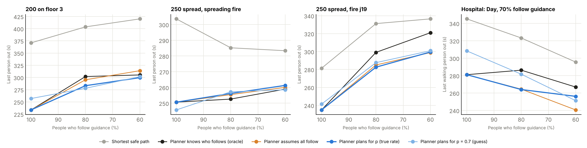

# When the planner does not know who will follow it (Phase 2)

Look-ahead planner, 20 paired seeds; true compliance 100% / 80% / 60%, and when below 100% half of the non-followers herd (copy the crowd's exit). Generated by `python -m evac.compliance_study`.

## Findings

1. **The planner does not need to know who will follow it.** Until now it was told exactly who ignores guidance ('oracle') - unrealistic. A planner that cannot tell and assumes everyone follows ('naive') is 3.4% FASTER on average at 80% / 60% compliance. So the earlier results did not depend on that free knowledge. It is not because of herding (a check without herding gives the same gap); a plausible reason, not yet verified, is that the oracle books every non-follower BEFORE everyone else, holding back followers who are ready earlier, while naive keeps one queue in order of readiness.
2. **Planning for non-compliance ('aware': each person's capacity split between the recommended route and the familiar exit by the compliance rate) helps only sometimes**: significantly faster than naive in 2 of 8 cases (200 people on floor 3: about -4%), significantly slower in 1, no difference in the rest. It helps when the non-followers all converge on one familiar exit that the planner would otherwise also fill.
3. With the rate guessed (0.7 whatever the truth) it is faster than naive in 2 and slower in 2 cases, and when everyone actually follows, the wrong guess costs up to +10%.
4. **Conclusion**: keep the simple planner; report compliance-awareness as tested and not worth it in general. The robust finding is that look-ahead stays well ahead of shortest path at every compliance level without knowing who complies (table below).

## Mean of 20 seeds (campus: last person out; hospital: last walking person out, seconds)

| Scenario | Follow guidance | Shortest safe path | Planner knows who follows (oracle) | Planner assumes all follow | Planner plans for p (true rate) | Planner plans for p = 0.7 (guess) |
| --- | --- | --- | --- | --- | --- | --- |
| 200 on floor 3 | 100% | 371 | 234 | 234 | 234 | 257 |
| 200 on floor 3 | 80% | 404 | 302 | 295 | 283 | 278 |
| 200 on floor 3 | 60% | 420 | 305 | 314 | 300 | 302 |
| 250 spread, spreading fire | 100% | 304 | 251 | 251 | 251 | 246 |
| 250 spread, spreading fire | 80% | 285 | 253 | 255 | 256 | 257 |
| 250 spread, spreading fire | 60% | 283 | 259 | 260 | 261 | 259 |
| 250 spread, fire j19 | 100% | 281 | 235 | 235 | 235 | 241 |
| 250 spread, fire j19 | 80% | 331 | 299 | 285 | 283 | 288 |
| 250 spread, fire j19 | 60% | 336 | 321 | 299 | 300 | 301 |
| Hospital: Day, 70% follow guidance | 100% | 345 | 281 | 281 | 281 | 308 |
| Hospital: Day, 70% follow guidance | 80% | 323 | 286 | 264 | 264 | 282 |
| Hospital: Day, 70% follow guidance | 60% | 296 | 267 | 241 | 256 | 251 |

## Aware vs naive, aware vs oracle (paired, Wilcoxon p < 0.05 marked *)

| Scenario | Follow guidance | Aware vs naive | Aware vs oracle | Aware 0.7 vs naive |
| --- | --- | --- | --- | --- |
| 200 on floor 3 | 80% | -4.1%* | -6.2%* | -5.9%* |
| 200 on floor 3 | 60% | -4.5%* | -1.8% | -3.9%* |
| 250 spread, spreading fire | 80% | +0.3% | +1.4% | +0.7% |
| 250 spread, spreading fire | 60% | +0.5% | +0.9% | -0.6% |
| 250 spread, fire j19 | 80% | -0.9% | -5.5%* | +0.9% |
| 250 spread, fire j19 | 60% | +0.2% | -6.7%* | +0.7% |
| Hospital: Day, 70% follow guidance | 80% | -0.2% | -7.8%* | +6.5%* |
| Hospital: Day, 70% follow guidance | 60% | +6.5%* | -4.0%* | +4.4%* |

Settings: `config.PLANNER_COMPLIANCE_MODEL` ('oracle' default / 'naive' / 'aware') and `config.PLANNER_ASSUMED_COMPLIANCE`. Non-followers head for the familiar exit (the main entrance); herders copy the most common exit of the queue they join.
