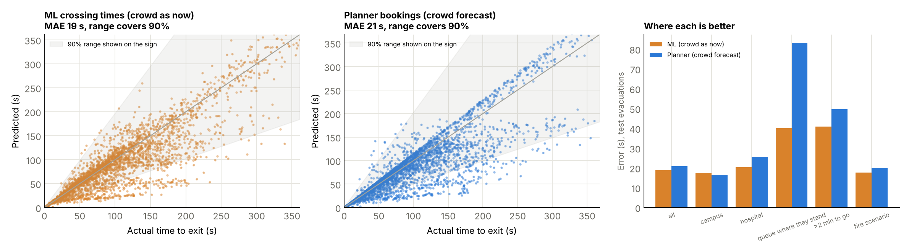

# Time-to-exit on signs: how good is the estimate? (Phase 2)

Every 30 s during look-ahead evacuations (4 campus + 3 hospital scenarios, 20 seeds) we recorded, for everyone inside and on the move, two predictions of their remaining time, then compared them with when they really got out. Ranges are calibrated on seeds 0-9 and tested on seeds 10-19 (conformal prediction). Generated by `python -m evac.eta_study`.

## Findings

1. **130,626 predictions** (64,902 on test evacuations).
2. **Raw estimates are optimistic**: the ML sum is off by -12 s on average and the planner's bookings by -22 s (people take longer than predicted: queues still forming, stragglers, non-followers). A single correction factor fixes most of it: x1.03 (ML), x1.16 (planner).
3. **After correction**: average error 19 s (ML) vs 21 s (planner). A 90% range is x/÷ 1.96 (ML) or x/÷ 2.02 (planner); on the test evacuations it held the real time for 90% / 90% of people.
4. **Ranges that fit the situation**: short estimates are relatively less certain than long ones, so the range is calibrated per band of predicted time (Mondrian conformal). ML: x/÷ 2.50, 2.65, 1.68, 1.61, 1.17 for estimates up to 30 s, 1, 2, 4 min and longer; coverage 91%, average range width 90 s (one-size range: 115 s).
5. The ML model's own range (built from crossing-level uncertainty, widened on real data) covered only 76% of whole-route times: errors along a route add up, so route-level ranges must be calibrated at route level - which is what the sign now uses.
6. **Signs use the ML sum** (lower error) with its range for its band of predicted time (`evac/eta_calibration.json`), on the dashboard route and the kiosk signs. The planner's booking forecast is kept for analysis: it is worse exactly where it matters, at a queue (error 83 s vs 40 s) - its 4-second slots over-simplify how a queue drains.

## By situation (test evacuations, after correction)

| Situation | Predictions | ML error (s) | ML range covers | Planner error (s) | Planner range covers |
| --- | --- | --- | --- | --- | --- |
| all | 64,902 | 19 | 90% | 21 | 90% |
| campus | 33,586 | 18 | 91% | 17 | 90% |
| hospital | 31,316 | 20 | 90% | 26 | 90% |
| queue where they stand (>= 5) | 1,823 | 40 | 89% | 83 | 50% |
| more than 2 min to go | 17,078 | 41 | 87% | 50 | 84% |
| fire scenario | 33,601 | 18 | 95% | 20 | 94% |

Honest limits: these are simulated people, so the check is that the estimate is consistent with the simulator, not with a real building. The real-data check of the crossing times is in `docs/ml_v3.md`.
