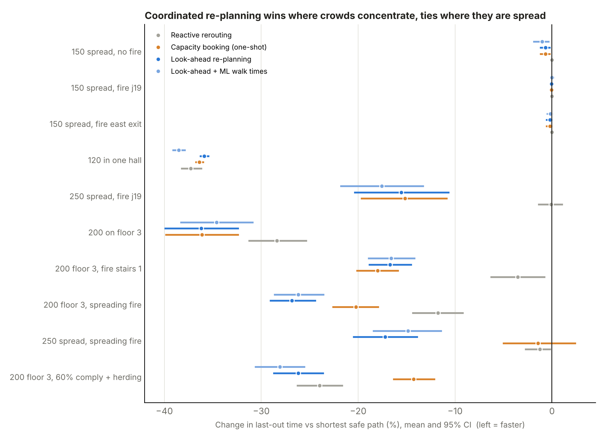
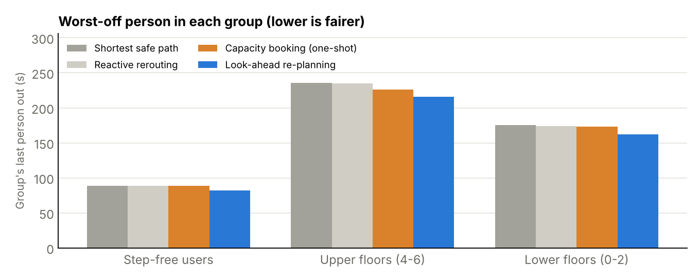
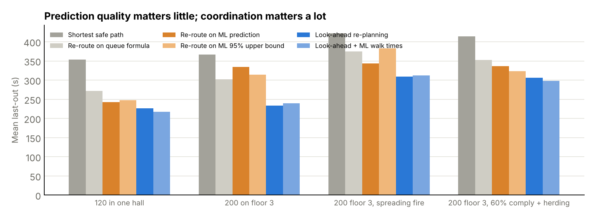
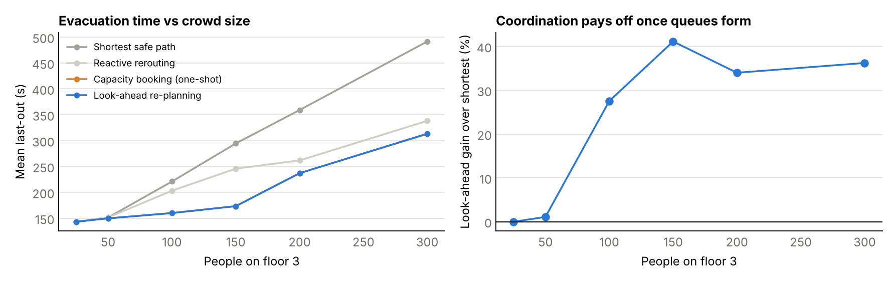
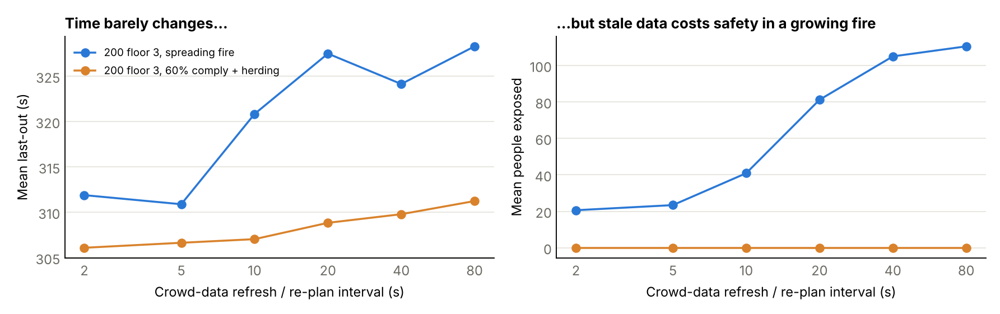
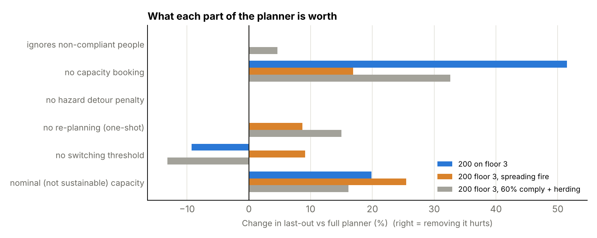

# Final results

Generated by `python -m evac.final_report` from 2766 simulation runs in `results/final_*.csv`. Every number below can be regenerated with `python -m evac.final_experiments` (seeded, deterministic). Simulator parameters: CALIBRATED on Juelich experiments, smoke slows walking (Improving-ML session; `docs/calibration.md`); ML predictor = v3 (`docs/ml_v3.md`). Results with the earlier handbook values: `docs/archive_handbook_params/final_results.md`.

## Key findings

1. Look-ahead re-planning was significantly faster than the shortest safe path in **8 of 10** scenarios (Wilcoxon, Holm-corrected p<0.05) and significantly slower in 0. Over all 300 paired runs it was faster in 223, tied in 75, slower in 2.
2. Largest gains (concentrated crowds): 200 on floor 3 -36%; 120 in one hall -36%; 200 floor 3, spreading fire -27%.
3. Look-ahead closes a median **37%** of the gap between shortest path and the theoretical lower bound (time-expanded max-flow, a bound no real routing can beat).
4. 'Nearest exit' is sometimes the fastest - but only because it walks people through the fire: in the 4 fire scenarios where it differs it exposed 99 people on average vs 1 for hazard-aware routing. Speed and safety must be read together.
5. In a spreading fire, re-planning trades a little time for much less smoke exposure (200 floor 3, spreading fire: one-shot 337 s / 120 exposed, look-ahead 309 s / 25 exposed; 250 spread, spreading fire: one-shot 297 s / 158 exposed, look-ahead 250 s / 87 exposed).
6. Fairness: look-ahead did not make any group's last person out later than shortest path (step-free 89->82 s, upper floors 236->216 s, lower floors 176->162 s).
7. ML vs coordination: swapping the queue formula for the ML predictor changed mean last-out by -3.5%; adding ML walk times to the coordinated planner -0.8%; but coordinating (capacity booking) instead of individually re-routing on the best prediction changed it by -14.4%. **The gain comes from coordination, not from prediction accuracy.**
8. A genetic algorithm with 721 full simulations per case (~4 min, offline) beat look-ahead only in: 120 in one hall (look-ahead: ~2 s, live): 120 in one hall GA 176 s vs look-ahead 228 s; 200 on floor 3 GA 368 s vs look-ahead 232 s; 250 spread, fire j19 GA 302 s vs look-ahead 220 s. Optimising exit choice alone cannot balance stairwells; in a single hall with several doors it can, but only offline.
9. Tipping point: on one floor, coordination gives a significant >=10% gain from about **100 people** upward; below that, shortest path is already as good (there are no queues to manage).
10. Data freshness: keeping last-out within 5% and exposure within 25% of the 2-second case needs crowd data refreshed every **5 s** (200 floor 3, spreading fire); **80 s** (200 floor 3, 60% comply + herding). When the fire is growing, stale data mostly costs SAFETY (exposure rises steeply), not time.
11. Ablations: the ingredients that matter most are 'no capacity booking' (up to +52% slower when removed) and 'nominal (not sustainable) capacity' (up to +25% slower when removed).
12. The 15% switching threshold is a deliberate trade: without it the planner is 4% faster on average but issues 3x as many route changes (52 -> 135 per run) - instructions that real people may not follow when signs keep flipping.

Related analyses: [calibration](calibration.md) (fit to real crowd data), [ML v3](ml_v3.md) (the learned crossing-time model, tested on real data), [sensitivity](sensitivity.md) (robustness to physical assumptions), [tuning](tuning.md) (Bayesian optimisation of planner settings), [weak spots](weakspots.md).

## 1. Main comparison: 10 scenarios x 6 methods x 30 paired seeds

Last-out time in seconds, mean [95% bootstrap CI]. Same 30 seeds (same people, same start positions, same pre-movement delays) for every method. Lower is better. **Bold** = fastest method among those that expose no more people to smoke/fire than the safest method in that row (+1 person or +10%) - a method that is faster only because it walks people through smoke does not count as best. Exposure is in the next table. Lower bound = time-expanded max-flow (3 seeds): it assumes everyone obeys, moves at free speed between bottlenecks and that the fire keeps its initial size, so it is looser for the compliance and spreading-fire scenarios.

| Scenario | Nearest exit | Shortest safe path | Reactive rerouting | Capacity booking (one-shot) | Look-ahead re-planning | Look-ahead + ML walk times | Lower bound |
| --- | --- | --- | --- | --- | --- | --- | --- |
| 150 spread, no fire | 187 [185-190] | 187 [185-190] | 187 [185-190] | 186 [183-189] | 186 [183-189] | **185 [182-189]** | 158 |
| 150 spread, fire j19 | 234 [231-236] | 202 [199-206] | 202 [199-206] | **202 [199-206]** | 202 [199-206] | 202 [199-206] | 158 |
| 150 spread, fire east exit | 252 [246-258] | 207 [202-212] | 207 [202-212] | **206 [202-211]** | 206 [202-211] | 206 [202-211] | 171 |
| 120 in one hall | 354 [352-355] | 354 [352-355] | 222 [219-226] | 225 [224-226] | 227 [225-228] | **217 [215-220]** | 118 |
| 250 spread, fire j19 | 274 [266-284] | 280 [266-294] | 280 [266-293] | 238 [229-247] | 237 [229-246] | **231 [226-236]** | 163 |
| 200 on floor 3 | 367 [356-377] | 367 [356-377] | 263 [258-268] | 234 [228-240] | **234 [228-240]** | 240 [233-246] | 143 |
| 200 floor 3, fire stairs 1 | 396 [387-406] | 372 [364-380] | 359 [353-364] | **305 [302-308]** | 310 [307-314] | 310 [307-314] | 165 |
| 200 floor 3, spreading fire | 422 [412-433] | 422 [412-433] | 373 [368-377] | 337 [334-340] | **309 [306-313]** | 312 [309-315] | 165 |
| 250 spread, spreading fire | 302 [293-311] | 302 [293-311] | 298 [291-305] | 297 [290-307] | **250 [245-254]** | 257 [252-262] | 163 |
| 200 floor 3, 60% comply + herding | 414 [405-423] | 414 [405-423] | 315 [311-318] | 355 [350-360] | 306 [302-309] | **298 [294-301]** | 143 |

Mean number of people exposed to smoke or fire (entered a node above the exposure threshold):

| Scenario | Nearest exit | Shortest safe path | Reactive rerouting | Capacity booking (one-shot) | Look-ahead re-planning | Look-ahead + ML walk times |
| --- | --- | --- | --- | --- | --- | --- |
| 150 spread, fire j19 | 103.9 | 1.9 | 1.9 | 1.9 | 1.9 | 1.9 |
| 150 spread, fire east exit | 11.6 | 1.1 | 1.1 | 1.1 | 1.1 | 1.1 |
| 250 spread, fire j19 | 172.6 | 2.7 | 2.7 | 2.7 | 2.7 | 2.7 |
| 200 floor 3, fire stairs 1 | 109.3 | 0.0 | 0.0 | 0.0 | 0.0 | 0.0 |
| 200 floor 3, spreading fire | 109.3 | 109.3 | 49.8 | 119.7 | 24.5 | 24.8 |
| 250 spread, spreading fire | 171.3 | 171.3 | 169.0 | 157.7 | 87.0 | 86.7 |

(Scenarios without fire, or where no method exposed anyone, are omitted.)

### Look-ahead re-planning vs shortest safe path (paired, per scenario)

Difference = look-ahead minus shortest (negative = look-ahead faster). Wilcoxon signed-rank, Holm-corrected over the 10 scenarios. 'Wins' = seeds where look-ahead was strictly faster / tied / slower.

| Scenario | Mean diff (s) [95% CI] | Change | Wins / ties / losses | p (Holm) | Exposed people: shortest -> look-ahead |
| --- | --- | --- | --- | --- | --- |
| 150 spread, no fire | -1.3 [-2.2, -0.5] | -0.7% | 12 / 18 / 0 | 0.006 | 0.0 -> 0.0 |
| 150 spread, fire j19 | -0.1 [-0.2, +0.0] | -0.0% | 1 / 29 / 0 | 0.317 | 1.9 -> 1.9 |
| 150 spread, fire east exit | -0.5 [-1.1, +0.0] | -0.2% | 3 / 27 / 0 | 0.218 | 1.1 -> 1.1 |
| 120 in one hall | -126.9 [-128.3, -125.5] | -35.9% | 30 / 0 / 0 | <0.001 | 0.0 -> 0.0 |
| 250 spread, fire j19 | -43.6 [-57.0, -30.0] | -15.6% | 27 / 1 / 2 | <0.001 | 2.7 -> 2.7 |
| 200 on floor 3 | -132.7 [-146.3, -118.9] | -36.2% | 30 / 0 / 0 | <0.001 | 0.0 -> 0.0 |
| 200 floor 3, fire stairs 1 | -62.1 [-70.1, -54.1] | -16.7% | 30 / 0 / 0 | <0.001 | 0.0 -> 0.0 |
| 200 floor 3, spreading fire | -113.4 [-122.8, -103.3] | -26.8% | 30 / 0 / 0 | <0.001 | 109.3 -> 24.5 |
| 250 spread, spreading fire | -51.9 [-61.8, -42.0] | -17.2% | 30 / 0 / 0 | <0.001 | 171.3 -> 87.0 |
| 200 floor 3, 60% comply + herding | -108.4 [-118.8, -97.8] | -26.2% | 30 / 0 / 0 | <0.001 | 0.0 -> 0.0 |

Share of the shortest-path-to-lower-bound gap closed by look-ahead: 150 spread, no fire 4%, 150 spread, fire j19 0%, 150 spread, fire east exit 1%, 120 in one hall 54%, 250 spread, fire j19 37%, 200 on floor 3 59%, 200 floor 3, fire stairs 1 30%, 200 floor 3, spreading fire 44%, 250 spread, spreading fire 37%, 200 floor 3, 60% comply + herding 40%.

Mean route changes per run (instructions people must follow): Nearest exit 4, Shortest safe path 4, Reactive rerouting 117, Capacity booking (one-shot) 4, Look-ahead re-planning 25, Look-ahead + ML walk times 29.

## 2. Fairness: who pays for a faster average?

A planner that speeds up the average by sending some people the long way could make the worst-off worse. Per group: mean exit time and the group's LAST person out, averaged over the building-wide scenarios (150 spread, no fire, 150 spread, fire j19, 150 spread, fire east exit, 250 spread, fire j19, 250 spread, spreading fire) x 30 seeds. Upper floors = 4-6, lower floors = 0-2.

| Method | Step-free: mean / last (s) | Upper floors: mean / last | Lower floors: mean / last | Everyone: mean / last |
| --- | --- | --- | --- | --- |
| Nearest exit | 78 / 100 | 176 / 250 | 100 / 187 | 139 / 250 |
| Shortest safe path | 71 / 89 | 171 / 236 | 92 / 176 | 132 / 236 |
| Reactive rerouting | 71 / 89 | 170 / 235 | 92 / 174 | 132 / 235 |
| Capacity booking (one-shot) | 71 / 89 | 163 / 226 | 92 / 173 | 128 / 226 |
| Look-ahead re-planning | 67 / 82 | 156 / 216 | 88 / 162 | 123 / 216 |
| Look-ahead + ML walk times | 67 / 82 | 156 / 216 | 88 / 161 | 123 / 216 |

## 3. Does a better predictor give better evacuations?

Same re-routing controller, three predictors of edge delay (queue formula / LightGBM / LightGBM 95% upper quantile), against the capacity-booking planner with formula or ML walk times. 30 seeds.

| Scenario | Shortest safe path | Re-route on queue formula | Re-route on ML prediction | Re-route on ML 95% upper bound | Look-ahead re-planning | Look-ahead + ML walk times |
| --- | --- | --- | --- | --- | --- | --- |
| 120 in one hall | 354 [352-355] | 272 [267-276] | 242 [239-246] | 248 [243-253] | 227 [225-228] | 217 [215-220] |
| 200 on floor 3 | 367 [356-377] | 302 [297-309] | 335 [325-344] | 314 [305-324] | 234 [228-240] | 240 [233-246] |
| 200 floor 3, spreading fire | 422 [412-433] | 375 [365-383] | 344 [332-356] | 383 [373-391] | 309 [306-313] | 312 [309-315] |
| 200 floor 3, 60% comply + herding | 414 [405-423] | 353 [349-357] | 336 [330-342] | 324 [318-330] | 306 [302-309] | 298 [294-301] |

Paired tests (Holm-corrected over scenarios):

- Re-route on ML prediction vs Re-route on queue formula: 120 in one hall -10.8% (p <0.001); 200 on floor 3 +10.7% (p <0.001); 200 floor 3, spreading fire -8.4% (p <0.001); 200 floor 3, 60% comply + herding -4.7% (p <0.001)
- Re-route on ML 95% upper bound vs Re-route on ML prediction: 120 in one hall +2.3% (p 0.094); 200 on floor 3 -6.1% (p 0.001); 200 floor 3, spreading fire +11.3% (p <0.001); 200 floor 3, 60% comply + herding -3.8% (p <0.001)
- Look-ahead + ML walk times vs Look-ahead re-planning: 120 in one hall -4.1% (p <0.001); 200 on floor 3 +2.4% (p 0.051); 200 floor 3, spreading fire +0.9% (p 0.075); 200 floor 3, 60% comply + herding -2.6% (p <0.001)
- Look-ahead re-planning vs Re-route on ML prediction: 120 in one hall -6.5% (p <0.001); 200 on floor 3 -30.1% (p <0.001); 200 floor 3, spreading fire -10.0% (p <0.001); 200 floor 3, 60% comply + herding -9.1% (p <0.001)

## 4. Offline benchmark: genetic algorithm

A genetic algorithm searches exit assignments (one exit per room-subgroup) by running the full simulation for every candidate - the kind of optimiser used in published evacuation work (e.g. Abdelghany et al. 2014). It needs hundreds of simulations, so it is an offline benchmark, not something that can run during a fire.

| Scenario | Seed | GA last-out (s) | GA simulations | GA compute (s) | Look-ahead last-out (s) | Look-ahead compute (s) | Shortest (s) | Lower bound (s) |
| --- | --- | --- | --- | --- | --- | --- | --- | --- |
| 120 in one hall | 0 | 180 | 721 | 151 | 234 | 1.3 | 356 | 118 |
| 120 in one hall | 1 | 172 | 721 | 145 | 222 | 1.1 | 354 | 118 |
| 200 on floor 3 | 0 | 352 | 721 | 290 | 251 | 2.3 | 352 | 142 |
| 200 on floor 3 | 1 | 384 | 721 | 309 | 214 | 2.4 | 385 | 144 |
| 250 spread, fire j19 | 0 | 360 | 721 | 312 | 225 | 2.5 | 360 | 162 |
| 250 spread, fire j19 | 1 | 244 | 721 | 252 | 215 | 2.3 | 244 | 162 |

Why the GA can lose badly on a full floor: its genome chooses only the EXIT for each group of people; the route to that exit (and so the stairwell) is still the shortest one, and everyone leaves as soon as they are ready. Look-ahead chooses the whole route and, through capacity booking, the timing. When the bottleneck is the stairwells rather than the exits (200 people on one floor), exit choice alone cannot balance them. A richer genome (stairwell + exit) would close some of this gap at a higher search cost.

## 5. Tipping point: at what crowd size does coordination start to matter?

200-person floor-3 scenario with the head-count varied (10 seeds each). Mean last-out (s):

| People | Shortest safe path | Reactive rerouting | Capacity booking (one-shot) | Look-ahead re-planning | Look-ahead advantage | p |
| --- | --- | --- | --- | --- | --- | --- |
| 25 | 143 | 143 | 143 | 143 | -0% | n/a |
| 50 | 151 | 151 | 150 | 150 | 1% | 0.016 |
| 100 | 221 | 203 | 160 | 160 | 28% | 0.002 |
| 150 | 295 | 246 | 173 | 173 | 41% | 0.002 |
| 200 | 359 | 262 | 237 | 237 | 34% | 0.002 |
| 300 | 492 | 338 | 313 | 314 | 36% | 0.002 |

## 6. How fresh must the crowd data be?

Look-ahead re-planning with the crowd state refreshed every 2-80 s (10 seeds). In a real building this is the update interval of the occupancy sensors / camera counts. Mean last-out (s) and exposed people:

| Re-plan interval (s) | 200 floor 3, spreading fire | 200 floor 3, 60% comply + herding |
| --- | --- | --- |
| 2 | 312 s, 20.6 exposed | 306 s, 0.0 exposed |
| 5 | 311 s, 23.4 exposed | 307 s, 0.0 exposed |
| 10 | 321 s, 40.9 exposed | 307 s, 0.0 exposed |
| 20 | 328 s, 81.2 exposed | 309 s, 0.0 exposed |
| 40 | 324 s, 105.0 exposed | 310 s, 0.0 exposed |
| 80 | 328 s, 110.5 exposed | 311 s, 0.0 exposed |

Acceptable refresh interval (last-out within 5% and exposure within 25% + 2 people of the 2 s case): 200 floor 3, spreading fire 5 s; 200 floor 3, 60% comply + herding 80 s.

## 7. Ablations: remove one ingredient at a time

Look-ahead planner with one ingredient switched off (10 seeds per scenario). Each cell: mean last-out (s) / mean exposed people / mean route changes, and change in last-out vs the full planner.

| Variant | 200 on floor 3 | 200 floor 3, spreading fire | 200 floor 3, 60% comply + herding |
| --- | --- | --- | --- |
| full | 237 s / 0.0 exp / 1 chg (+0%) | 311 s / 23.4 exp / 100 chg (+0%) | 307 s / 0.0 exp / 56 chg (+0%) |
| ignores non-compliant people | 237 s / 0.0 exp / 1 chg (+0%) | 311 s / 23.4 exp / 100 chg (+0%) | 321 s / 0.0 exp / 53 chg (+5%) |
| no capacity booking | 359 s / 0.0 exp / 0 chg (+52%) | 363 s / 16.4 exp / 91 chg (+17%) | 407 s / 0.0 exp / 35 chg (+33%) |
| no hazard detour penalty | 237 s / 0.0 exp / 1 chg (+0%) | 311 s / 25.5 exp / 98 chg (-0%) | 307 s / 0.0 exp / 56 chg (+0%) |
| no re-planning (one-shot) | 237 s / 0.0 exp / 0 chg (+0%) | 338 s / 119.4 exp / 0 chg (+9%) | 353 s / 0.0 exp / 36 chg (+15%) |
| no switching threshold | 215 s / 0.0 exp / 93 chg (-9%) | 339 s / 25.6 exp / 178 chg (+9%) | 266 s / 0.0 exp / 135 chg (-13%) |
| nominal (not sustainable) capacity | 284 s / 0.0 exp / 0 chg (+20%) | 390 s / 21.7 exp / 79 chg (+25%) | 356 s / 0.0 exp / 52 chg (+16%) |

## Limitations (stated openly)

1. **Simulated, not observed in this building.** All results come from our own discrete-time simulator. Its
   speed-density curve and door flow are CALIBRATED on real Juelich crowd experiments (`docs/calibration.md`),
   but those were students in a laboratory, and no drill has been timed in this building. Absolute times are
   therefore estimates; the *ranking* of methods is what the sensitivity analysis and both parameter sets
   (calibrated and handbook, `docs/archive_handbook_params/`) show to be robust.
2. **Two building geometries.** The framework is building-agnostic (`build_graph`); this report covers the
   campus, `docs/hospital_results.md` the hospital.
3. **Agents are simple.** No group behaviour beyond herding toward the crowd, no counter-flow of responders, no
   panic model, no physical pushing; compliance is a fixed probability per person.
4. **Fire and smoke are geometric.** Fire spreads as a growing radius and smoke climbs stair shafts on a timer;
   there is no CFD smoke model (e.g. FDS). Exposure = entering a node above the hazard threshold. Smoke slows
   walking (Frantzich & Nilsson 2003), but the mapping from our 0-1 hazard index to smoke density is assumed.
5. **Perfect sensing is assumed** for the planner (it knows everyone's position at each re-plan). Section 6 tests
   *staleness* of that data but not noise or missing counts.
6. **Lifts** are used only for step-free users without fire; lift dispatching is not modelled in detail.
7. **The ML delay model (v3) is trained on simulated crossings.** It is tested on real Juelich crossings
   (`docs/ml_v3.md`): about as accurate as the calibrated formula overall, better in queues, and its uncertainty
   range needed widening on real data. It has not been tested on real sensor data from a building.
8. **The theoretical lower bound** relaxes walking speeds to free-flow and discretises time (2 s steps), so it is
   a bound, not an achievable plan.
