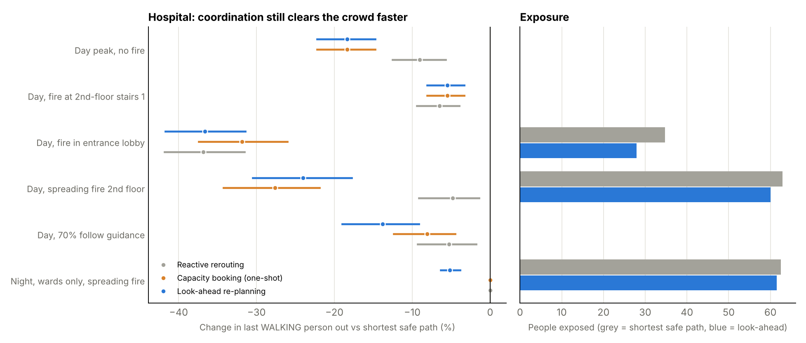
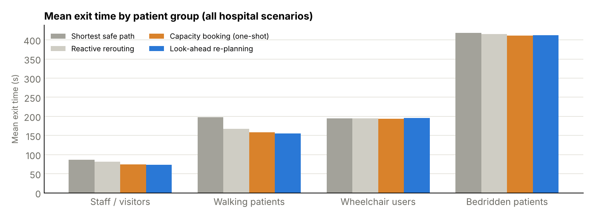
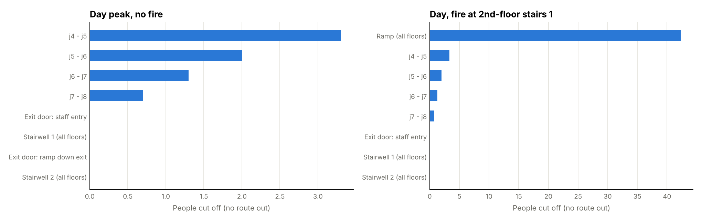
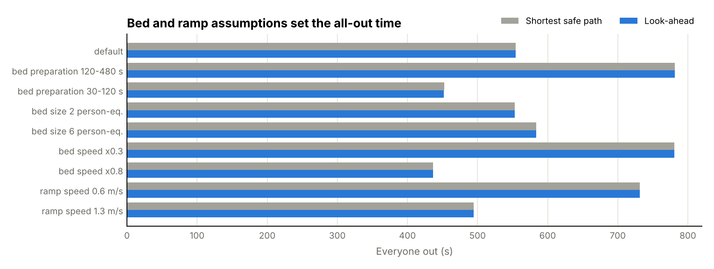

# Second building: oncology hospital

Generated by `python -m evac.hospital_report` from 1458 simulation runs (+ weak-spot runs) in `results/hosp_*`. Same engine, methods and statistics as the campus study (`final_results.md`); only the building data and the occupants changed.

## Key findings

1. **The main result transfers to a second, very different building.** Look-ahead re-planning cut the time until the last walking person is out in 6 of 6 hospital scenarios (significant, Holm-corrected), by up to 37% (Day, fire in entrance lobby).
2. But in a fire the time until EVERYONE is out barely moves (Day, fire at 2nd-floor stairs 1 +0%, Day, fire in entrance lobby -14%, Day, spreading fire 2nd floor +0%, Night, wards only, spreading fire +0%): with lifts out of service it is set by bedridden patients - bed preparation plus three floors of ramp - not by routing.
3. Fire in the entrance lobby: hazard-aware routing alone still sends people past the fire (35 exposed); capacity-aware planning spreads them over the other exits (28 exposed) at the cost of a longer average exit (264 -> 180 s).
4. **Night ward fire: routing cannot protect patients who cannot move quickly.** 62-62 of 90 people were exposed whatever the method. This is the quantitative case for hospital practice of **progressive horizontal evacuation** (move beds sideways to the next fire compartment first) - our next modelling step.
5. Bedridden patients wait longest by far (mean exit 412 s vs 74 s for staff/visitors under look-ahead) and the planner does not make them worse off (bed mean 418 -> 412 s); it gains time for the walking crowd without taking it from patients.
6. ML walk times (model v3, trained on the calibrated simulator incl. this building) inside the capacity planner: +2.4% vs the formula version on the hospital (ambulatory last-out, all scenarios) - no real gain: coordination, not prediction accuracy, drives the result (docs/ml_v3.md). Re-routing on ML predictions alone stays +6% behind coordinated planning - the same pattern as on campus.
7. **The ramp is the hospital's single point of failure.** With fire (lifts out), blocking it leaves **42 people** - all wheelchair users and beds above the ground floor - with no way out; no stairwell or door failure comes close. Without fire the bed lifts cover for it. A design / fire-safety-audit result of exactly the kind this tool is for.
8. Hospital assumptions move the everyone-out time a lot (436-781 s, mostly bed preparation and ramp speed) but the look-ahead advantage for the walking crowd stays 0%-8% in every variant.

## 1. The building and how it was loaded

**100-bedded Oncology Block, Government Hospital, Tiruppur (ground + 3 floors).** team-digitised nodes/edges over drawings HOS-TIR-ARCH-DD-1001..1004. Ground floor = outpatients (18 consulting rooms, waiting hall), 1st = laboratories, 2nd and 3rd = general wards (~40 beds per floor). Two stairwells, a passenger lift, two bed lifts and a switchback ramp serving every floor.

- Graph: 124 nodes, 155 edges (61 corridor, 5 exit_door, 9 lift, 3 ramp, 71 room_door, 6 stair); 54 rooms; exits: main entrance, ramp 1, ramp 2, staff entry, ramp down exit.
- Scale: ground: 54675 mm dimension line over pixels 387-5719; upper floors: least-squares fit of the 6 shared shafts to the ground floor. Ground 0.010254 m/px; upper floors f1 0.014825, f2 0.014809, f3 0.014831 m/px.
- **Cross-floor check:** after fitting, the six shared shafts on every upper floor land within **0.20 m** of their ground-floor position, so the team's digitisation is consistent between floors.
- Data fixes: `f2_general ward 2`-`f2_j5`: general ward 2 was reachable only by walking through wards 1 and 3; added its door to the corridor junction below it (~5 m); `f3_general ward 2`-`f3_j5`: same on the third floor.
- The team's scripts were not executed; values were read with `json` / `ast.literal_eval`.

**Occupants (assumptions, see `config.PROFILES`):**

| Profile | Speed | Stairs? | Capacity used | Preparation before moving |
| --- | --- | --- | --- | --- |
| Staff / visitors | x1.0 | yes | 1 person-eq. | 0-30 s |
| Walking patients | x0.6 | yes | 1 person-eq. | 10-60 s |
| Wheelchair users | x0.7 | no (ramp / lift) | 2 person-eq. | 20-90 s |
| Bedridden patients | x0.5 | no (ramp / lift) | 4 person-eq. | 60-240 s |

Ramp: 40 m of ramp per floor (two 8 m runs + landings each way, from the drawings), 2.1 m wide, 1.0 m/s. In a fire, lifts (including bed lifts) are out of service, so the **ramp is the only way out for wheelchair users and beds**.

## 2. Main comparison: 6 scenarios x 7 methods x 30 paired seeds

In a hospital the **last person out is almost always a bedridden patient**, whose time is set by bed preparation and the ramp, not by routing. So three numbers are reported: *ambulatory last-out* (last walking person out - what routing controls), *everyone out*, and *people exposed* to smoke/fire.

| Scenario | Method | Ambulatory last-out (s) [95% CI] | Everyone out (s) | Mean exit time (s) | Exposed | Cut off |
| --- | --- | --- | --- | --- | --- | --- |
| Day peak, no fire | Nearest exit | 341 [331-352] | 411 | 122 | 0.0 | 0.0 |
|  | Shortest safe path | 341 [331-352] | 411 | 122 | 0.0 | 0.0 |
|  | Reactive rerouting | 310 [302-321] | 404 | 117 | 0.0 | 0.0 |
|  | Capacity booking (one-shot) | 278 [262-295] | 360 | 107 | 0.0 | 0.0 |
|  | Look-ahead re-planning | 278 [262-295] | 358 | 107 | 0.0 | 0.0 |
|  | Look-ahead + ML walk times | 282 [269-295] | 355 | 108 | 0.0 | 0.0 |
| | *Lower bound (everyone out)* | | 283 | | | |
| Day, fire at 2nd-floor stairs 1 | Nearest exit | 372 [356-388] | 549 | 144 | 0.0 | 0.0 |
|  | Shortest safe path | 372 [356-388] | 549 | 144 | 0.0 | 0.0 |
|  | Reactive rerouting | 348 [335-360] | 549 | 140 | 0.0 | 0.0 |
|  | Capacity booking (one-shot) | 352 [335-370] | 549 | 139 | 0.0 | 0.0 |
|  | Look-ahead re-planning | 352 [335-370] | 549 | 139 | 0.0 | 0.0 |
|  | Look-ahead + ML walk times | 324 [306-343] | 549 | 135 | 0.0 | 0.0 |
| | *Lower bound (everyone out)* | | 313 | | | |
| Day, fire in entrance lobby | Nearest exit | 340 [330-352] | 549 | 152 | 107.0 | 0.0 |
|  | Shortest safe path | 626 [594-655] | 637 | 264 | 34.8 | 0.0 |
|  | Reactive rerouting | 395 [386-406] | 550 | 200 | 48.9 | 0.0 |
|  | Capacity booking (one-shot) | 426 [409-444] | 549 | 190 | 28.0 | 0.0 |
|  | Look-ahead re-planning | 396 [385-409] | 549 | 180 | 28.0 | 0.0 |
|  | Look-ahead + ML walk times | 439 [420-459] | 551 | 198 | 28.0 | 0.0 |
| | *Lower bound (everyone out)* | | 283 | | | |
| Day, spreading fire 2nd floor | Nearest exit | 323 [303-344] | 694 | 156 | 62.9 | 3.3 |
|  | Shortest safe path | 323 [303-344] | 694 | 156 | 62.9 | 3.3 |
|  | Reactive rerouting | 307 [292-322] | 694 | 154 | 62.9 | 3.3 |
|  | Capacity booking (one-shot) | 234 [225-244] | 694 | 138 | 62.4 | 3.3 |
|  | Look-ahead re-planning | 245 [231-262] | 697 | 142 | 60.0 | 3.3 |
|  | Look-ahead + ML walk times | 266 [250-283] | 697 | 145 | 58.3 | 3.3 |
| | *Lower bound (everyone out)* | | 283 | | | |
| Day, 70% follow guidance | Nearest exit | 318 [299-338] | 454 | 120 | 0.0 | 0.0 |
|  | Shortest safe path | 318 [299-338] | 454 | 120 | 0.0 | 0.0 |
|  | Reactive rerouting | 301 [287-317] | 407 | 116 | 0.0 | 0.0 |
|  | Capacity booking (one-shot) | 292 [273-312] | 416 | 113 | 0.0 | 0.0 |
|  | Look-ahead re-planning | 274 [256-293] | 389 | 109 | 0.0 | 0.0 |
|  | Look-ahead + ML walk times | 277 [261-294] | 355 | 107 | 0.0 | 0.0 |
| | *Lower bound (everyone out)* | | 283 | | | |
| Night, wards only, spreading fire | Nearest exit | 220 [215-225] | 710 | 325 | 62.5 | 0.0 |
|  | Shortest safe path | 220 [215-225] | 710 | 325 | 62.5 | 0.0 |
|  | Reactive rerouting | 220 [215-225] | 710 | 325 | 62.5 | 0.0 |
|  | Capacity booking (one-shot) | 220 [215-225] | 710 | 325 | 62.5 | 0.0 |
|  | Look-ahead re-planning | 209 [205-213] | 711 | 327 | 61.5 | 0.0 |
|  | Look-ahead + ML walk times | 209 [205-213] | 711 | 327 | 60.5 | 0.0 |
| | *Lower bound (everyone out)* | | 291 | | | |

Lower bound: time-expanded max-flow at free walking speed, ignoring bed size and preparation - valid but loose in a hospital.

### Look-ahead vs shortest safe path (paired, Holm-corrected Wilcoxon over the 6 scenarios)

| Scenario | Ambulatory last-out change | p | Mean exit time change | p | Exposed: shortest -> look-ahead |
| --- | --- | --- | --- | --- | --- |
| Day peak, no fire | -18% | <0.001 | -12% | <0.001 | 0.0 -> 0.0 |
| Day, fire at 2nd-floor stairs 1 | -6% | <0.001 | -3% | <0.001 | 0.0 -> 0.0 |
| Day, fire in entrance lobby | -37% | <0.001 | -32% | <0.001 | 34.8 -> 28.0 |
| Day, spreading fire 2nd floor | -24% | <0.001 | -9% | <0.001 | 62.9 -> 60.0 |
| Day, 70% follow guidance | -14% | <0.001 | -9% | <0.001 | 0.0 -> 0.0 |
| Night, wards only, spreading fire | -5% | <0.001 | +1% | <0.001 | 62.5 -> 61.5 |

## 3. Who waits longest? Outcomes per patient group

Mean / last exit time per group, averaged over all six scenarios x 30 seeds.

| Group | Shortest safe path | Reactive rerouting | Capacity booking (one-shot) | Look-ahead re-planning |
| --- | --- | --- | --- | --- |
| Staff / visitors | 86 / 245 | 81 / 215 | 75 / 196 | 74 / 191 |
| Walking patients | 198 / 367 | 167 / 314 | 159 / 300 | 155 / 292 |
| Wheelchair users | 195 / 306 | 195 / 306 | 194 / 301 | 196 / 300 |
| Bedridden patients | 418 / 560 | 415 / 551 | 411 / 546 | 412 / 542 |

Share of each group exposed to smoke or fire (all scenarios): Staff / visitors 4% -> 3%; Walking patients 6% -> 5%; Wheelchair users 28% -> 28%; Bedridden patients 35% -> 35% (shortest safe path -> look-ahead).

## 4. Does the ML model transfer to a building it never saw?

The delay model was trained only on the campus building (no ramps, no beds, no slow patients). Here it is used unchanged - a test of whether a learned component generalises.

| Scenario | Look-ahead (formula) | Look-ahead + ML walk times | Re-route on ML prediction |
| --- | --- | --- | --- |
| Day peak, no fire | 278 | 282 | 278 |
| Day, fire at 2nd-floor stairs 1 | 352 | 324 | 335 |
| Day, fire in entrance lobby | 396 | 439 | 443 |
| Day, spreading fire 2nd floor | 245 | 266 | 297 |
| Day, 70% follow guidance | 274 | 277 | 290 |
| Night, wards only, spreading fire | 209 | 209 | 209 |

(Ambulatory last-out time, seconds, mean of 30 seeds.)

## 5. Weak spots: which single failure hurts the hospital most?

Each row blocks one element (a whole stairwell, the ramp, an exit door, a key corridor) and re-runs the same evacuation with look-ahead re-planning (3 seeds).

**Day peak, no fire** (baseline everyone out 347.7 s):

| Blocked | Everyone out (+s) | Average person (+s) | People cut off |
| --- | --- | --- | --- |
| Corridor j4 - j5 | +20 | +34 | 3 |
| Corridor j5 - j6 | +5 | +25 | 2 |
| Corridor j6 - j7 | +0 | +13 | 1 |
| Corridor j7 - j8 | +0 | +12 | 1 |
| Exit door: staff entry | +148 | +8 | 0 |
| Stairwell 1 (all floors) | +35 | +20 | 0 |
| Exit door: ramp down exit | +30 | -2 | 0 |
| Stairwell 2 (all floors) | +10 | +12 | 0 |

**Day, fire at 2nd-floor stairs 1** (baseline everyone out 559.8 s):

| Blocked | Everyone out (+s) | Average person (+s) | People cut off |
| --- | --- | --- | --- |
| Ramp (all floors) | -169 | -29 | 42 |
| Corridor j4 - j5 | +0 | +13 | 3 |
| Corridor j5 - j6 | +0 | +1 | 2 |
| Corridor j6 - j7 | +0 | -6 | 1 |
| Corridor j7 - j8 | +0 | -11 | 1 |
| Exit door: staff entry | +37 | +7 | 0 |
| Stairwell 1 (all floors) | +0 | +3 | 0 |
| Stairwell 2 (all floors) | +0 | -11 | 0 |

'Everyone out' counts only people who get out: when the ramp is blocked it DROPS because the 42 slowest people (beds, wheelchairs) are cut off and no longer counted - read it together with the last column.

## 6. How much do the hospital assumptions matter?

One assumption changed at a time; scenario 'Day, fire at 2nd-floor stairs 1'; 10 seeds.

| Variant | Everyone out: shortest / look-ahead (s) | Ambulatory last-out: shortest / look-ahead (s) | Look-ahead gain (ambulatory) |
| --- | --- | --- | --- |
| default | 554 / 554 | 387 / 374 | 3% |
| bed preparation 120-480 s | 781 / 781 | 387 / 374 | 3% |
| bed preparation 30-120 s | 452 / 452 | 386 / 373 | 3% |
| bed size 2 person-eq. | 553 / 553 | 387 / 374 | 3% |
| bed size 6 person-eq. | 584 / 584 | 387 / 374 | 3% |
| bed speed x0.3 | 781 / 781 | 387 / 374 | 3% |
| bed speed x0.8 | 437 / 436 | 387 / 374 | 3% |
| ramp speed 0.6 m/s | 731 / 731 | 387 / 386 | 0% |
| ramp speed 1.3 m/s | 494 / 494 | 271 / 250 | 8% |

Why the ramp speed changes the routing gain: walking the 3-floor ramp (3 x 40 m at 1.0 m/s) takes about as long as the stairs (3 x 8 m at 0.65 m/s), so at the default speed shortest-path routing puts everyone on the stairs and the planner can divert part of the crowd onto the idle ramp (30% gain). A slow ramp is no real alternative (8%); a fast ramp is already chosen by shortest-path routing (10%). **Coordination pays most when there is spare capacity that simple routing ignores.**

## 7. Campus vs hospital: what generalises

| Question | Campus (7 floors, 452 nodes) | Hospital (4 floors, 124 nodes) |
| --- | --- | --- |
| Largest look-ahead gain | 36% (last-out) | 37% (ambulatory last-out) |
| Median gain over scenarios | 17% | 16% |
| Where it helps | concentrated crowds (full floor / hall) | the outpatient crowd on the ground floor |
| What limits it | stair capacity | bed preparation + the single ramp |
| ML model | trained here | used unchanged: walk times off for ramps/beds (retrain per building); coordination still wins |

## Limitations specific to the hospital

1. Only ground + 3 floors were digitised (the drawings' area statement lists more floors); upper floors would add load to the ramp.
2. Staff are not modelled as a limited resource: in reality each bed needs 2+ staff, so beds would move in waves.
3. Progressive horizontal evacuation (moving patients sideways into the next fire compartment), the standard
   hospital procedure, is not modelled yet; the results show exactly why it matters (night ward fire).
4. Profile speeds, bed size and preparation times are assumptions in published ranges, not measurements here;
   section 6 shows the routing conclusion does not depend on them.
5. Occupancy (310 by day, 90 at night) is an estimate from the room schedule, not hospital data.
