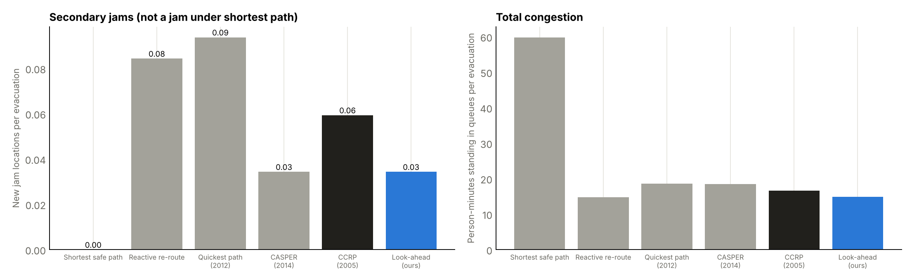

# Does guidance just move the jam? Secondary jams (Phase 2)

A jam = at least 10 people waiting at one node for at least 10 s. A SECONDARY jam is a jam at a node that is not a jam when everyone takes the shortest safe path - a bottleneck created by the guidance itself (the effect Choi et al. 2021 found for dynamic exit signs). 16 scenarios (10 campus, 6 hospital) x 20 paired seeds x 6 methods. Generated by `python -m evac.jam_study`.

## Findings

1. **Shortest path** has 0.8 jam locations per evacuation and 60 person-minutes of queueing.
2. **Look-ahead** has 0.5 jam locations, of which 0.03 are new (secondary), lasting 1 s in total; queueing drops to 15 person-minutes (-75%).
3. Most secondary jams: Quickest path (2012) (0.09 per evacuation, 4 s). Reactive re-route 0.08; CASPER (2014) 0.03; CCRP (2005) 0.06; Look-ahead (ours) 0.03.
4. Look-ahead's secondary jams are mostly at: g_stairs 2 (4 runs), f1_stairs 4 (3 runs), f2_stairs 2 (2 runs), f2_stairs 3 (1 runs).
5. **Reading it**: in our buildings Choi's effect exists but is small. With 10-person jams every method creates fewer than 0.1 new jam locations per evacuation; with a stricter 5-person definition (table below) the purely reactive method creates the most (it moves people toward whatever queue it cannot see yet), and the three methods that plan with capacity in mind (CASPER, CCRP, look-ahead) the fewest. The bigger effect is total queueing: every guided method cuts it by 68-75%, and look-ahead has the lowest together with reactive re-routing - while also being the fastest overall.

## All methods (mean per evacuation, all 16 scenarios)

| Method | Jam locations | Jam-seconds | Secondary jams | Secondary jam-seconds | Person-minutes queueing | Last out (s) |
| --- | --- | --- | --- | --- | --- | --- |
| Shortest safe path | 0.84 | 105 | 0.00 | 0 | 60 | 412 |
| Reactive re-route | 0.54 | 12 | 0.08 | 1 | 15 | 377 |
| Quickest path (2012) | 0.66 | 33 | 0.09 | 4 | 19 | 371 |
| CASPER (2014) | 0.36 | 27 | 0.03 | 1 | 18 | 393 |
| CCRP (2005) | 0.56 | 33 | 0.06 | 1 | 17 | 367 |
| Look-ahead (ours) | 0.47 | 29 | 0.03 | 1 | 15 | 359 |

## Sensitivity: a smaller jam (>= 5 people waiting for >= 10 s)

| Method | Jam locations | Secondary jams | Secondary jam-seconds |
| --- | --- | --- | --- |
| Shortest safe path | 1.40 | 0.00 | 0 |
| Reactive re-route | 1.78 | 0.53 | 9 |
| Quickest path (2012) | 1.17 | 0.27 | 8 |
| CASPER (2014) | 0.82 | 0.20 | 4 |
| CCRP (2005) | 1.03 | 0.22 | 4 |
| Look-ahead (ours) | 0.97 | 0.22 | 4 |

## Secondary jams per scenario (mean per evacuation)

| Scenario | Reactive re-route | Quickest path (2012) | CASPER (2014) | CCRP (2005) | Look-ahead (ours) |
| --- | --- | --- | --- | --- | --- |
| 150 spread, no fire | 0.00 | 0.00 | 0.00 | 0.00 | 0.00 |
| 150 spread, fire j19 | 0.00 | 0.00 | 0.00 | 0.00 | 0.00 |
| 150 spread, fire east exit | 0.00 | 0.00 | 0.00 | 0.00 | 0.00 |
| 120 in one hall | 1.00 | 1.00 | 0.00 | 0.20 | 0.15 |
| 250 spread, fire j19 | 0.00 | 0.00 | 0.20 | 0.00 | 0.00 |
| 200 on floor 3 | 0.20 | 0.05 | 0.10 | 0.00 | 0.00 |
| 200 floor 3, fire stairs 1 | 0.05 | 0.15 | 0.10 | 0.10 | 0.05 |
| 200 floor 3, spreading fire | 0.05 | 0.05 | 0.00 | 0.25 | 0.05 |
| 250 spread, spreading fire | 0.00 | 0.15 | 0.00 | 0.00 | 0.00 |
| 200 floor 3, 60% comply + herding | 0.05 | 0.00 | 0.05 | 0.15 | 0.10 |
| H: Day peak, no fire | 0.00 | 0.00 | 0.00 | 0.00 | 0.00 |
| H: Day, fire at 2nd-floor stairs 1 | 0.00 | 0.00 | 0.00 | 0.00 | 0.00 |
| H: Day, fire in entrance lobby | 0.00 | 0.05 | 0.05 | 0.20 | 0.20 |
| H: Day, spreading fire 2nd floor | 0.00 | 0.05 | 0.05 | 0.00 | 0.00 |
| H: Day, 70% follow guidance | 0.00 | 0.00 | 0.00 | 0.05 | 0.00 |
| H: Night, wards only, spreading fire | 0.00 | 0.00 | 0.00 | 0.00 | 0.00 |

Thresholds: `config.JAM_QUEUE` (10 people) and `config.JAM_MIN_S` (10 s).
