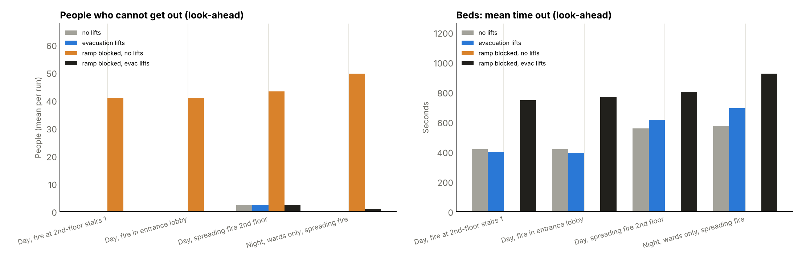

# Evacuation lifts in the hospital (Phase 2)

The two bed lifts as fire-protected evacuation lifts for wheelchair users and beds (car: one group of up to 4 person-equivalents per round trip, ~1 m/s, 30 s doors/loading; ASSUMPTIONS - see config.py). 4 hospital fire scenarios x 10 paired seeds. Generated by `python -m evac.lift_study`.

## Findings

1. **Lifts as a back-up save lives.** With the ramp out of service and no lifts, on average 44 people (all wheelchair users and beds above the ground floor) cannot get out. With evacuation lifts: 0.8 (a few, only in the two spreading-fire scenarios, are cut off by the fire or still queueing at the simulation's 30-minute limit). Everyone-out time then: Day, fire at 2nd-floor stairs 1 1331 s, Day, fire in entrance lobby 1360 s, Day, spreading fire 2nd floor 1441 s, Night, wards only, spreading fire 1648 s.
2. **With the ramp working, safe_shortest**: everyone-out 658 s without lifts vs 1753 s with them (+166%); beds' mean 487 -> 986 s; 43 people use the lifts.
3. **With the ramp working, ccrp**: everyone-out 627 s without lifts vs 740 s with them (+18%); beds' mean 487 -> 479 s; 15 people use the lifts.
4. **With the ramp working, lookahead**: everyone-out 627 s without lifts vs 880 s with them (+40%); beds' mean 492 -> 526 s; 26 people use the lifts.
5. **Reading it**: a lift car moves one bed (or two wheelchairs) per round trip of about a minute and a half; the 2.1 m ramp keeps moving beds continuously. So when the ramp works, sending people to the lifts makes them wait, and our planners, which book each floor-to-floor lift link separately, underestimate that wait - they send too many. Evacuation lifts are a back-up for when the ramp is lost, not a faster route in a 4-storey hospital with a ramp. Recommendation: keep lifts for people who have no safe ramp route.

## Look-ahead, mean of seeds

| Scenario | Variant | Everyone out (s) | Not out | Beds mean (s) | Wheelchairs mean (s) | Lift users | Exposed |
| --- | --- | --- | --- | --- | --- | --- | --- |
| Day, fire at 2nd-floor stairs 1 | no lifts | 554 | 0.0 | 418 | 182 | 0 | 0.0 |
| Day, fire at 2nd-floor stairs 1 | evacuation lifts | 508 | 0.0 | 400 | 176 | 18 | 0.0 |
| Day, fire at 2nd-floor stairs 1 | ramp blocked, no lifts | 386 | 40.9 | - | 86 | 0 | 0.0 |
| Day, fire at 2nd-floor stairs 1 | ramp blocked, evac lifts | 1331 | 0.0 | 747 | 316 | 41 | 0.0 |
| Day, fire in entrance lobby | no lifts | 554 | 0.0 | 418 | 186 | 0 | 29.9 |
| Day, fire in entrance lobby | evacuation lifts | 524 | 0.0 | 394 | 178 | 17 | 29.9 |
| Day, fire in entrance lobby | ramp blocked, no lifts | 698 | 40.9 | - | 96 | 0 | 29.9 |
| Day, fire in entrance lobby | ramp blocked, evac lifts | 1360 | 0.0 | 769 | 327 | 41 | 29.9 |
| Day, spreading fire 2nd floor | no lifts | 698 | 2.3 | 556 | 240 | 0 | 59.0 |
| Day, spreading fire 2nd floor | evacuation lifts | 1159 | 2.3 | 615 | 241 | 32 | 59.0 |
| Day, spreading fire 2nd floor | ramp blocked, no lifts | 259 | 43.2 | - | 86 | 0 | 18.1 |
| Day, spreading fire 2nd floor | ramp blocked, evac lifts | 1441 | 2.3 | 803 | 295 | 41 | 59.0 |
| Night, wards only, spreading fire | no lifts | 702 | 0.0 | 573 | 344 | 0 | 63.2 |
| Night, wards only, spreading fire | evacuation lifts | 1328 | 0.0 | 694 | 330 | 38 | 63.2 |
| Night, wards only, spreading fire | ramp blocked, no lifts | 206 | 49.6 | - | - | 0 | 13.6 |
| Night, wards only, spreading fire | ramp blocked, evac lifts | 1648 | 1.0 | 923 | 530 | 50 | 62.4 |

Settings: `config.EVAC_LIFTS`, `EVAC_LIFT_NAMES`, `LIFT_CAR_CAPACITY`, `LIFT_SPEED`, `LIFT_DOOR_LOAD_S`, `LIFT_LOAD_WINDOW_S`. Lift evacuation literature: Kinsey, Galea & Lawrence (2012); Ronchi & Nilsson (2013).
