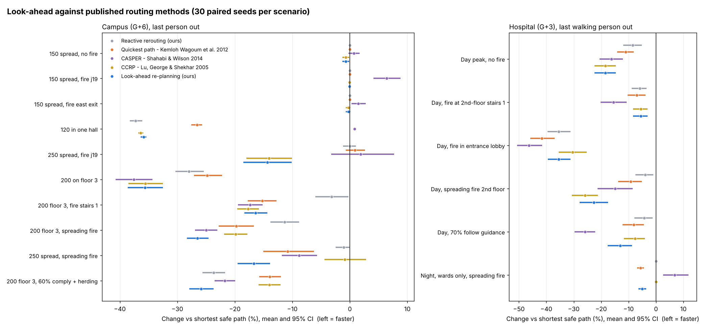

# Look-ahead against published routing methods

Generated by `python -m evac.literature_experiments`. Two published methods were added (`evac/literature.py`) and run through the same 30-seed paired experiment as the main results: the same people, start times and fires for every method. CCRP was already one of our baselines.

| Method | Source | Type |
|---|---|---|
| Quickest path | Kemloh Wagoum, Seyfried & Holl 2012 | local, reactive: each person switches when the estimated walk + queue time of another route is clearly lower (cba > 0.15) |
| CASPER | Shahabi & Wilson 2014 | global, planned once: one route per room, edge cost grows with the people already routed over it |
| CCRP | Lu, George & Shekhar 2005 | global, planned once: books time slots on every door and stair |
| **Look-ahead (ours)** | this work | CCRP-style booking, re-planned every 5 s over a 300 s horizon |

## Summary

- **Campus** - look-ahead vs Quickest path: faster in 7, tie in 3, slower in 0 of 10; vs CASPER: faster in 7, tie in 3, slower in 0 of 10; vs CCRP: faster in 3, tie in 5, slower in 2 of 10.
- **Hospital** (last walking person out) - look-ahead vs Quickest path: faster in 1, tie in 4, slower in 1 of 6; vs CASPER: faster in 2, tie in 1, slower in 3 of 6; vs CCRP: faster in 3, tie in 3, slower in 0 of 6.

- Campus, vs Quickest path: largest gain -16% (250 spread, fire j19); weakest -0% (150 spread, fire j19).
- Campus, vs CASPER: largest gain -36% (120 in one hall); weakest +3% (200 on floor 3).
- Hospital, vs Quickest path: largest gain -15% (Day, spreading fire 2nd floor); weakest +11% (Day, fire in entrance lobby).
- Hospital, vs CASPER: largest gain -11% (Night, wards only, spreading fire); weakest +21% (Day, fire in entrance lobby).

## What it means

- Against the two methods that do not book capacity over time (quickest path, CASPER) look-ahead is clearly better wherever crowds concentrate, and never significantly worse on campus.
- CCRP, the published method our planner builds on, is as good as look-ahead in calm scenarios (1-2% better in two of them). With the calibrated simulator look-ahead is clearly better wherever plans go stale: in spreading fires (8-16% faster AND far fewer people in smoke) and when only 60% follow guidance and others herd (14% faster). Honest claim: 'CCRP-style booking is the key ingredient; re-planning makes it robust to a changing fire and to people who do not follow'.
- Hospital: CASPER (one route per room, planned once) is faster for the walking crowd in 3 of 6 scenarios (13-21%). In the entrance-lobby fire that speed comes from walking more people past the smoke (67 exposed vs 28); in the other two it is a genuine weakness of look-ahead in this building, not yet analysed (earlier, with handbook parameters, look-ahead won 4 of 6 against CASPER).
- Quickest path, a local method, avoids smoke best in spreading fires (people re-route as soon as they see the fire) but cannot prevent the stair jams that a global plan avoids.

## Campus - time until the last person is out (s)

| Scenario | Shortest safe | Reactive | Quickest path | CASPER | CCRP | Look-ahead |
|---|---|---|---|---|---|---|
| 150 spread, no fire | 187 | 187 | 187 | 189 | **186** | **186** |
| 150 spread, fire j19 | **202** | **202** | **202** | 215 | **202** | **202** |
| 150 spread, fire east exit | **207** | **207** | **207** | 210 | **206** | **206** |
| 120 in one hall | 354 | **222** | 260 | 356 | 225 | 227 |
| 250 spread, fire j19 | 280 | 280 | 283 | 282 | 238 | **237** |
| 200 on floor 3 | 367 | 263 | 274 | **227** | 234 | 234 |
| 200 floor 3, fire stairs 1 | 372 | 359 | 314 | 306 | **305** | 310 |
| 200 floor 3, spreading fire | 422 | 373 | 337 | 316 | 337 | **309** |
| 250 spread, spreading fire | 302 | 298 | 268 | 275 | 297 | **250** |
| 200 floor 3, 60% comply + herding | 414 | 315 | 355 | 323 | 355 | **306** |

Mean time (s) over 30 seeds; bold = fastest.

### Look-ahead head-to-head (campus)

| Scenario | vs Quickest path | vs CASPER | vs CCRP |
|---|---|---|---|
| 150 spread, no fire | ✓ -1% | ✓ -1% | +0% (n.s.) |
| 150 spread, fire j19 | -0% (n.s.) | ✓ -6% | +0% (n.s.) |
| 150 spread, fire east exit | -0% (n.s.) | ✓ -2% | +0% (n.s.) |
| 120 in one hall | ✓ -13% | ✓ -36% | ✗ +1% |
| 250 spread, fire j19 | ✓ -16% | ✓ -16% | -0% (n.s.) |
| 200 on floor 3 | ✓ -15% | +3% (n.s.) | -0% (n.s.) |
| 200 floor 3, fire stairs 1 | -1% (n.s.) | +1% (n.s.) | ✗ +2% |
| 200 floor 3, spreading fire | ✓ -8% | -2% (n.s.) | ✓ -8% |
| 250 spread, spreading fire | ✓ -7% | ✓ -9% | ✓ -16% |
| 200 floor 3, 60% comply + herding | ✓ -14% | ✓ -5% | ✓ -14% |

Look-ahead's change against each method (negative = look-ahead faster). ✓/✗ = significant (paired Wilcoxon, Holm-corrected over the scenarios, p < 0.05); n.s. = no significant difference.

## Hospital - time until the last walking person is out (s)

| Scenario | Shortest safe | Reactive | Quickest path | CASPER | CCRP | Look-ahead |
|---|---|---|---|---|---|---|
| Day peak, no fire | 341 | 310 | 301 | 284 | **278** | **278** |
| Day, fire at 2nd-floor stairs 1 | 372 | 348 | 344 | **311** | 352 | 352 |
| Day, fire in entrance lobby | 626 | 395 | 356 | **327** | 426 | 396 |
| Day, spreading fire 2nd floor | 323 | 307 | 288 | 267 | **234** | 245 |
| Day, 70% follow guidance | 318 | 301 | 287 | **231** | 292 | 274 |
| Night, wards only, spreading fire | 220 | 220 | **208** | 235 | 220 | 209 |

Mean time (s) over 30 seeds; bold = fastest.

### Look-ahead head-to-head (hospital)

| Scenario | vs Quickest path | vs CASPER | vs CCRP |
|---|---|---|---|
| Day peak, no fire | -8% (n.s.) | -2% (n.s.) | -0% (n.s.) |
| Day, fire at 2nd-floor stairs 1 | +2% (n.s.) | ✗ +13% | -0% (n.s.) |
| Day, fire in entrance lobby | ✗ +11% | ✗ +21% | ✓ -7% |
| Day, spreading fire 2nd floor | ✓ -15% | ✓ -8% | +5% (n.s.) |
| Day, 70% follow guidance | -5% (n.s.) | ✗ +19% | ✓ -6% |
| Night, wards only, spreading fire | +1% (n.s.) | ✓ -11% | ✓ -5% |

Look-ahead's change against each method (negative = look-ahead faster). ✓/✗ = significant (paired Wilcoxon, Holm-corrected over the scenarios, p < 0.05); n.s. = no significant difference.

## Hospital - time until EVERYONE is out (s)

Bedridden patients need staff, so this is set by the bed evacuation rather than by routing.

| Scenario | Shortest safe | Reactive | Quickest path | CASPER | CCRP | Look-ahead |
|---|---|---|---|---|---|---|
| Day peak, no fire | 411 | 404 | 362 | 537 | 360 | **358** |
| Day, fire at 2nd-floor stairs 1 | **549** | **549** | **549** | 552 | **549** | **549** |
| Day, fire in entrance lobby | 637 | 550 | **549** | **549** | **549** | **549** |
| Day, spreading fire 2nd floor | **694** | **694** | **694** | 696 | **694** | 697 |
| Day, 70% follow guidance | 454 | 407 | **379** | 521 | 416 | 389 |
| Night, wards only, spreading fire | **710** | **710** | **710** | 711 | **710** | 711 |

Mean time (s) over 30 seeds; bold = fastest.

## People exposed to smoke (mean per run)

| Scenario | Shortest safe | Reactive | Quickest path | CASPER | CCRP | Look-ahead |
|---|---|---|---|---|---|---|
| 150 spread, fire j19 | 2 | 2 | 2 | 12 | 2 | 2 |
| 150 spread, fire east exit | 1 | 1 | 1 | 1 | 1 | 1 |
| 250 spread, fire j19 | 3 | 3 | 3 | 32 | 3 | 3 |
| 200 floor 3, spreading fire | 109 | 50 | 0 | 79 | 120 | 25 |
| 250 spread, spreading fire | 171 | 169 | 11 | 128 | 158 | 87 |
| Hospital: Day, fire in entrance lobby | 35 | 49 | 44 | 67 | 28 | 28 |
| Hospital: Day, spreading fire 2nd floor | 63 | 63 | 59 | 58 | 62 | 60 |
| Hospital: Night, wards only, spreading fire | 62 | 62 | 61 | 60 | 62 | 62 |

## How the published methods were put on our graph

- **Quickest path**: the paper's pedestrians re-decide on entering a new room and when stuck in a jam longer than their patience (10 s, +1 s per unsuccessful attempt); they switch only if the cost-benefit (g_alt - g_cur)/(g_alt + g_cur) with g = 1/estimated time exceeds 0.15. On the graph every node is a decision point and the estimated time is walking time at the current density plus the time for the queue ahead to clear (the paper estimates this from a 'reference pedestrian' in the jam).
- **CASPER**: sources (rooms) are processed from the farthest to the nearest; each gets one route that minimises the sum of edge costs, where an edge's cost uses the people already routed over it plus its own group. CASPER leaves the traffic model T open; ours is the pedestrian version max(walking time, people / sustainable capacity) x hazard penalty.
- All methods share the simulator, safety rules (no walking into fire, no lifts in a fire, step-free people avoid stairs) and the same people. Non-compliant people ignore every method equally.

## Reproducibility check

Stored runs of the other methods were re-run with the current code before being reused:

| Scenario | Method | Seed | Stored (s) | Re-run (s) |
|---|---|---|---|---|
| floor3_full_200 | lookahead | 3 | 245.5 | 245.5 |
| crowd_250_fire_j19 | ccrp | 5 | 216.5 | 216.5 |
| floor3_200_spreading_fire_stairs1 | safe_shortest | 7 | 380.5 | 380.5 |
| hosp_day_peak | lookahead | 2 | 341.5 | 341.5 |
| hosp_day_fire_lobby | safe_shortest | 4 | 753.5 | 753.5 |

## References

- Kemloh Wagoum, A. U., Seyfried, A. & Holl, S. (2012). Modeling the dynamic route choice of pedestrians to assess the criticality of building evacuation. Advances in Complex Systems 15(7). doi:10.1142/S0219525912500294
- Shahabi, K. & Wilson, J. P. (2014). CASPER: Intelligent capacity-aware evacuation routing. Computers, Environment and Urban Systems 46, 12-24. doi:10.1016/j.compenvurbsys.2014.03.004
- Lu, Q., George, B. & Shekhar, S. (2005). Capacity constrained routing algorithms for evacuation planning: a summary of results. SSTD 2005, LNCS 3633, 291-307.
