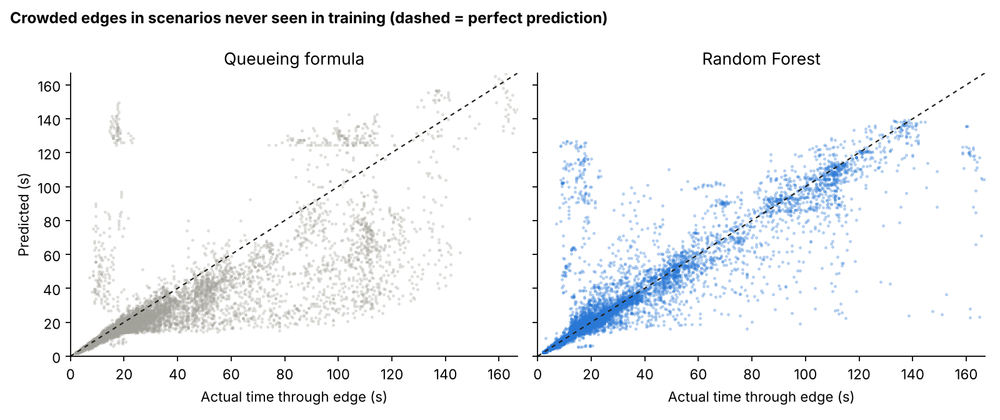

# Does ML earn its place? Learned delay predictor vs formulas

Data: 237,405 edge crossings from 160 simulated evacuations (random crowd sizes, layouts, static/spreading fires, 60-100% compliance). Target = actual seconds to get through an edge (queue wait + walk). Labels come from the simulator, not a formula.

| Split | Edges | Model | MAE (s) | R² |
| --- | --- | --- | --- | --- |
| random rows (leaky) | all edges (n=59,194) | free-flow | 4.63 | 0.055 |
| random rows (leaky) | all edges (n=59,194) | queueing formula | 2.69 | 0.705 |
| random rows (leaky) | all edges (n=59,194) | Random Forest | 1.51 | 0.927 |
| random rows (leaky) | crowded (queue ahead > 0) (n=9,971) | free-flow | 17.41 | -0.26 |
| random rows (leaky) | crowded (queue ahead > 0) (n=9,971) | queueing formula | 8.36 | 0.622 |
| random rows (leaky) | crowded (queue ahead > 0) (n=9,971) | Random Forest | 3.51 | 0.923 |
| by scenario | all edges (n=57,517) | free-flow | 5.31 | 0.033 |
| by scenario | all edges (n=57,517) | queueing formula | 3.04 | 0.688 |
| by scenario | all edges (n=57,517) | Random Forest | 1.96 | 0.842 |
| by scenario | crowded (queue ahead > 0) (n=10,815) | free-flow | 18.73 | -0.303 |
| by scenario | crowded (queue ahead > 0) (n=10,815) | queueing formula | 9.14 | 0.585 |
| by scenario | crowded (queue ahead > 0) (n=10,815) | Random Forest | 5.28 | 0.792 |
| by fire location | all edges (n=50,393) | free-flow | 4.92 | 0.043 |
| by fire location | all edges (n=50,393) | queueing formula | 2.92 | 0.667 |
| by fire location | all edges (n=50,393) | Random Forest | 1.97 | 0.85 |
| by fire location | crowded (queue ahead > 0) (n=9,570) | free-flow | 16.16 | -0.255 |
| by fire location | crowded (queue ahead > 0) (n=9,570) | queueing formula | 8.34 | 0.57 |
| by fire location | crowded (queue ahead > 0) (n=9,570) | Random Forest | 4.86 | 0.826 |

Fire locations held out in the 'by fire location' split: f1_j12, f1_j16, f2_j12, f2_j13, f2_j17, f2_j19, f2_j20, f2_j4, f3_j1, f3_j13, f3_j20, f3_j3, f3_j4, f4_j13, f4_j14, f4_j4, f4_j5, f5_j10, f5_j12, f6_j11, f6_j14, f6_j18.

Most important features (Random Forest, scenario split): density (0.56), planned_users (0.20), length_m (0.08), queue_at_node (0.06), queue_ahead (0.06), on_edge (0.02).

## Verdict

- On crowded edges in unseen scenarios, the Random Forest beats the queueing formula (MAE 5.28 s vs 9.14 s).
- Leakage check: random-row split R² 0.927 vs scenario split R² 0.842. A large drop would mean the old random split overstated accuracy.
- The old model (trained on a hand-written formula) should be retired: it cannot learn anything the formula does not already say.

