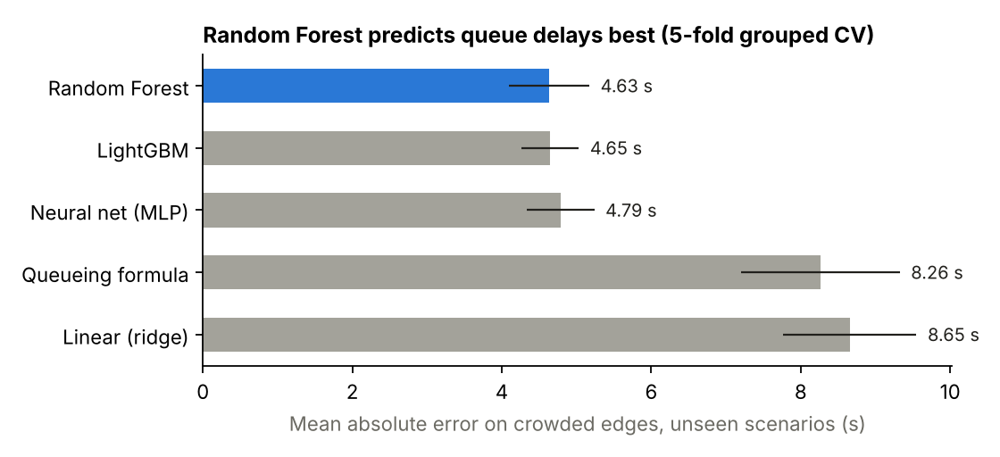
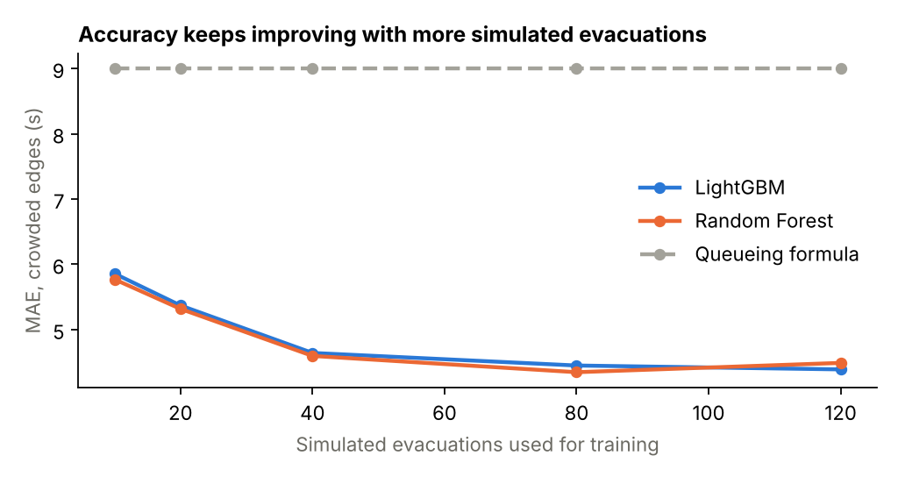
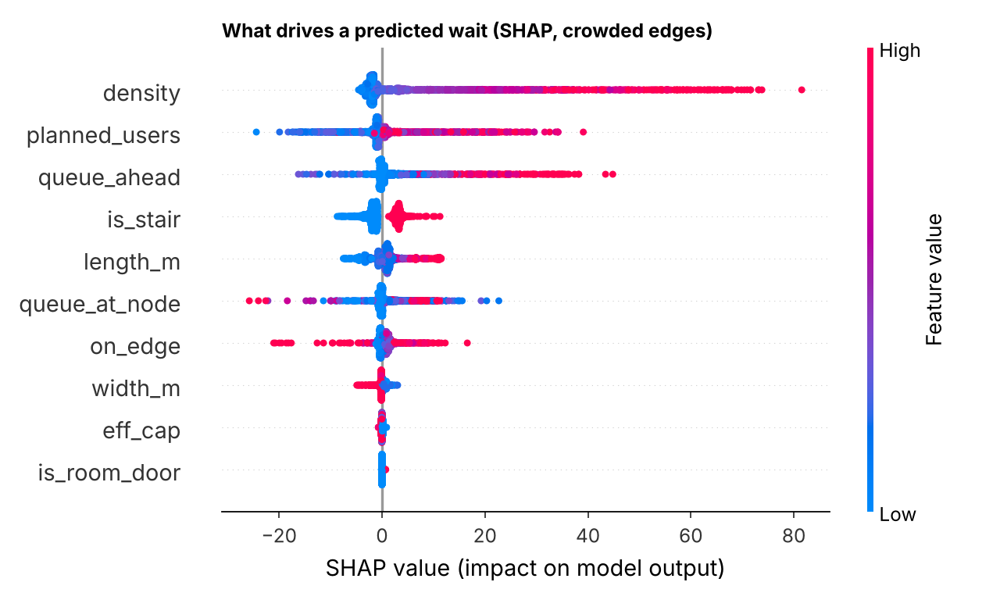
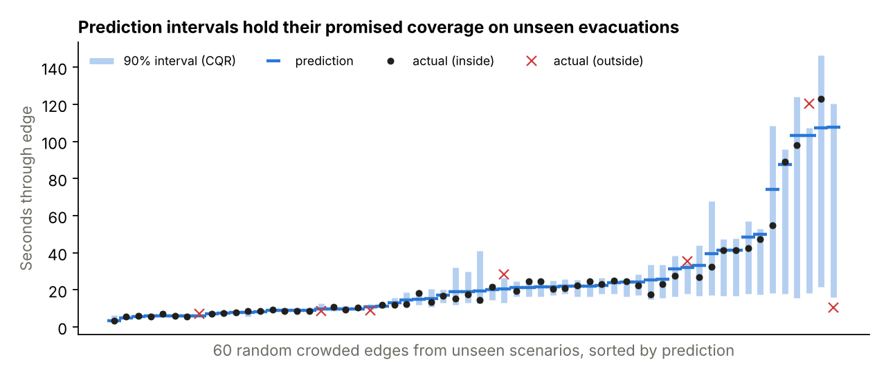

# ML study: which model, how much data, why, and how sure

Data: 237,405 simulated edge crossings from 160 evacuations (cross-validation used a 40% per-scenario sample for speed). Target = seconds to get through an edge.

## 1. Model comparison (5-fold grouped CV: whole evacuations held out)

| Model | MAE crowded (s) | ± sd | R² crowded | MAE all (s) | R² all |
| --- | --- | --- | --- | --- | --- |
| Random Forest | 4.63 | 0.54 | 0.859 | 1.75 | 0.881 |
| LightGBM | 4.65 | 0.38 | 0.857 | 1.75 | 0.879 |
| Neural net (MLP) | 4.79 | 0.45 | 0.854 | 1.79 | 0.878 |
| Queueing formula | 8.26 | 1.06 | 0.623 | 2.70 | 0.705 |
| Linear (ridge) | 8.65 | 0.90 | 0.719 | 3.61 | 0.753 |

## 2. Learning curve

| Training evacuations | LightGBM MAE crowded | Random Forest | Formula |
| --- | --- | --- | --- |
| 10 | 5.86 | 5.77 | 9.00 |
| 20 | 5.37 | 5.32 | 9.00 |
| 40 | 4.64 | 4.60 | 9.00 |
| 80 | 4.45 | 4.35 | 9.00 |
| 120 | 4.39 | 4.49 | 9.00 |

## 3. What drives a predicted wait (SHAP)

Mean |SHAP| on crowded edges: density (9.9 s), planned_users (3.8 s), queue_ahead (3.3 s), is_stair (2.6 s), length_m (2.2 s), queue_at_node (1.5 s).

## 4. Uncertainty: conformal prediction (target 90% coverage on unseen evacuations)

| Method | Coverage all | Coverage crowded | Coverage uncrowded | Width crowded (s) | Width uncrowded (s) |
| --- | --- | --- | --- | --- | --- |
| Split conformal (Mondrian) | 89.8% | 91.4% | 89.6% | 24.7 | 4.2 |
| Conformalised quantile regression | 91.3% | 89.0% | 91.7% | 19.1 | 4.7 |

CQR adapts the interval width to each edge (narrow when free-flowing, wide in a jam), so its intervals are far more useful than one fixed band.

_Runtime 193 s. Saved models: models/delay_lgbm.joblib (point), models/delay_lgbm_q95.joblib (upper 95% quantile)._
