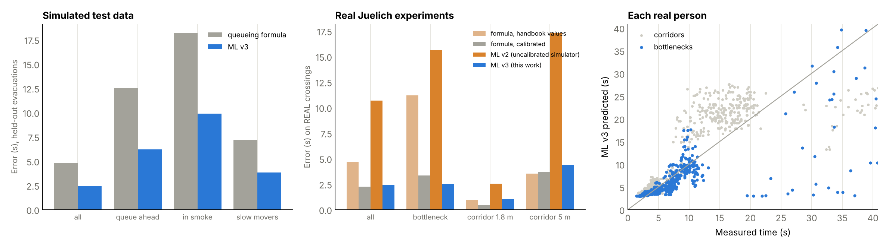

# Improving ML: one model, calibrated simulator, tested on real data

See `evac/ml_v3.py`. Calibration: `docs/calibration.md`.

## Findings

1. **Dataset**: 784,014 edge crossings from the CALIBRATED simulator (smoke slows walking): campus, hospital and 600 random simple geometries (doors 0.5-2.4 m, corridors 1-5.5 m, walkers, patients, wheelchairs, beds). Labels are simulated crossing times, not a formula.
2. **Simulated test data** (whole evacuations held out, 5-fold): error 4.76 s (formula) -> 2.41 s (ML), 49% lower. Where it matters most - someone already queued ahead - 12.5 s -> 6.2 s; in smoke 18.2 s -> 9.9 s. Its 90% range contains the true time for 89% of crossings.
3. **Real data** (1,813 people measured in the Juelich experiments, never used for training): error formula, handbook values 4.66 s, formula, calibrated 2.23 s, ML v2 (uncalibrated simulator) 10.67 s, ML v3 (this work) 2.44 s. On the bottlenecks (queues): formula, handbook values 11.17 s, formula, calibrated 3.35 s, ML v2 (uncalibrated simulator) 15.61 s, ML v3 (this work) 2.49 s. The simulated 90% range covers only 51% of real crossings (real people vary more than simulated ones); after conformal calibration on half of the real runs it covers 88% on the other half (was 35%). Time-to-exit ranges on signs use this widened range (x/÷ 1.35 per crossing).
4. **Why a hybrid model.** A pure ML model trained on the same data (like v2) was accurate on simulated data (2.93 s) but poor on real people (7.16 s): it had never seen e.g. 5 m wide corridors. v3 instead learns a CORRECTION to the physics formula (time = formula x learned factor) from physics-based inputs: simulated 2.53 s, real 2.12 s (formula alone: 5.25 s / 2.23 s).
5. **Never-seen building**: trained without the hospital, tested on it: formula 6.09 s, ML 5.36 s; trained without the campus, tested on it: formula 3.03 s, ML 1.70 s.
6. **In the planner** (10 seeds x 11 scenarios): capacity planner with ML walking times vs formula: mean +0.4% (range -6.5% to +9.6%); simple re-router with ML delays vs formula delays: mean -2.9% (range -11.2% to +10.8%). Negative = ML faster.

## Simulated test data (held-out evacuations)

| Subset | Rows | Mean time (s) | MAE formula (s) | MAE ML (s) | 90% range covers |
| --- | --- | --- | --- | --- | --- |
| all crossings | 784,014 | 19.0 | 4.76 | 2.41 | 89% |
| someone queued ahead | 220,418 | 38.3 | 12.49 | 6.18 | 87% |
| in smoke (hazard >= 0.3) | 38,199 | 49.6 | 18.19 | 9.88 | 83% |
| slow movers (patients, wheelchairs, beds) | 242,522 | 26.3 | 7.17 | 3.83 | 89% |
| edge type: room_door | 148,069 | 20.5 | 5.00 | 2.05 | 87% |
| edge type: exit_door | 127,983 | 12.7 | 2.42 | 1.41 | 89% |
| edge type: corridor | 365,054 | 9.6 | 1.56 | 0.66 | 90% |
| edge type: stair | 116,681 | 41.9 | 14.09 | 7.93 | 89% |
| edge type: ramp | 13,778 | 87.1 | 11.47 | 9.41 | 86% |
| building: campus | 294,215 | 13.7 | 3.03 | 1.52 | 90% |
| building: hospital | 310,822 | 21.5 | 6.09 | 3.05 | 89% |
| building: synthetic | 178,977 | 23.4 | 5.31 | 2.76 | 86% |

## Real data (Juelich experiments)

Each person walking through a 4 m corridor section (corridor runs) or through the last 3 m and the door (bottleneck runs) is one test row, with the same features the simulator logs (people ahead, density, people still to come). Mean absolute error in seconds:

| Real test set | Crossings | Mean measured (s) | formula, handbook values | formula, calibrated | ML v2 (uncalibrated simulator) | ML v3 (this work) | v3 90% range covers |
| --- | --- | --- | --- | --- | --- | --- | --- |
| all | 1,813 | 7.3 | 4.66 | 2.23 | 10.67 | 2.44 | 51% |
| bottleneck | 520 | 8.5 | 11.17 | 3.35 | 15.61 | 2.49 | 81% |
| corridor 1.8 m | 754 | 3.5 | 0.98 | 0.41 | 2.52 | 1.02 | 23% |
| corridor 5 m | 539 | 11.5 | 3.51 | 3.71 | 17.30 | 4.37 | 60% |

## Design choices (ablation: one grouped 75/25 split + all real crossings)

| Variant | MAE simulated (held out) | MAE real (all) | MAE real: bottleneck | MAE real: corridor 1.8 m | MAE real: corridor 5 m |
| --- | --- | --- | --- | --- | --- |
| physics formula only (calibrated) | 5.25 | 2.23 | 3.35 | 0.41 | 3.71 |
| pure ML, raw features (like v2) | 2.93 | 7.16 | 11.90 | 1.10 | 11.06 |
| pure ML + physics features | 2.68 | 2.81 | 3.45 | 1.30 | 4.32 |
| hybrid: physics x learned correction (v3) | 2.53 | 2.12 | 2.44 | 1.04 | 3.31 |

## A building the model has never seen

| Test building | Trained on | MAE formula (s) | MAE ML (s) |
| --- | --- | --- | --- |
| hospital | campus + synthetic | 6.09 | 5.36 |
| campus | hospital + synthetic | 3.03 | 1.70 |

## In the planner (mean of 10 seeds; hospital = last walking person, campus = last person)

| Building | Scenario | Look-ahead, formula | Look-ahead, ML v3 | Re-router, formula | Re-router, ML v3 | Exposed (LA formula / LA ML) |
| --- | --- | --- | --- | --- | --- | --- |
| campus | building_250_spreading_fire_j19 | 254 | 251 | 263 | 246 | 88.6 / 88.2 |
| campus | crowd_250_fire_j19 | 232 | 233 | 289 | 292 | 2.7 / 2.7 |
| campus | floor3_200_spreading_fire_stairs1 | 311 | 313 | 380 | 340 | 23.4 / 24.2 |
| campus | floor3_full_200 | 237 | 246 | 296 | 328 | 0.0 / 0.0 |
| campus | lecture_hall_f1_120 | 226 | 216 | 275 | 244 | 0.0 / 0.0 |
| hospital | hosp_day_compliance70 | 291 | 286 | 294 | 303 | 0.0 / 0.0 |
| hospital | hosp_day_fire_lobby | 392 | 430 | 450 | 436 | 29.9 / 29.9 |
| hospital | hosp_day_fire_stairs1_f2 | 374 | 350 | 364 | 343 | 0.0 / 0.0 |
| hospital | hosp_day_peak | 300 | 291 | 302 | 276 | 0.0 / 0.0 |
| hospital | hosp_day_spreading_f2 | 256 | 274 | 319 | 314 | 59.0 / 57.8 |
| hospital | hosp_night_wards_fire | 206 | 206 | 206 | 206 | 63.2 / 62.0 |

## What changed from the old ML

| | v1 Random Forest | v2 LightGBM (Session 7) | v3 LightGBM (this work) |
| --- | --- | --- | --- |
| Labels | a hand-written cost formula + noise | simulated crossing times | simulated crossing times |
| Simulator checked against real people? | - | no (doors at ~half the real flow) | yes, calibrated on Juelich data |
| Smoke slows people | - | no | yes (Frantzich & Nilsson 2003) |
| Model | Random Forest | LightGBM | hybrid: physics formula x LightGBM correction |
| Training geometry | random numbers | campus + hospital | campus + hospital + 600 random geometries |
| Tested on real crossings | no | no | yes |
| Gives a range (for time-to-exit signs) | no | 95% upper only | 5%-95% range |
