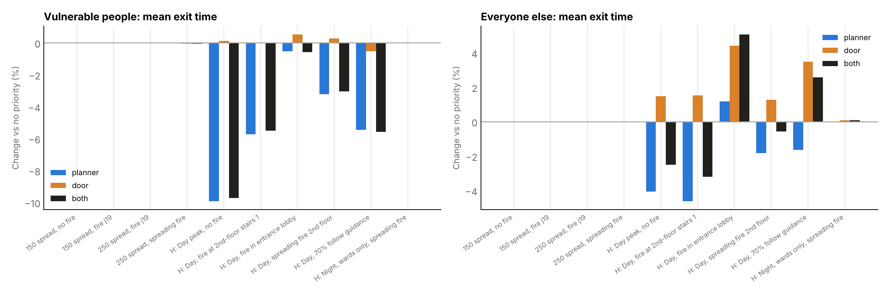

# Vulnerable people first: who gains, who pays? (Phase 2)

Look-ahead planner, 30 paired seeds per scenario (same people, same fires). 'Vulnerable' = slow walkers, wheelchair users, beds and anyone needing a step-free route (campus: 5% step-free people; hospital: patients). Generated by `python -m evac.priority_study`.

## Findings

1. **Planner books them first**: vulnerable people's mean exit time -2.5% on average (best -9.9%; significantly faster in 4 of 10 scenarios); everyone else -1.1% (worst +1.2%; significantly slower in 0); time until the last person is out -0.0%.
2. **Let through first at queues**: vulnerable people's mean exit time +0.0% on average (best -0.5%; significantly faster in 2 of 10 scenarios); everyone else +1.2% (worst +4.4%; significantly slower in 7); time until the last person is out +0.0%.
3. **Both**: vulnerable people's mean exit time -2.4% on average (best -9.7%; significantly faster in 6 of 10 scenarios); everyone else +0.1% (worst +5.1%; significantly slower in 3); time until the last person is out +0.0%.
4. Vulnerable people in smoke (sum over scenarios, mean per run): none 124.3, planner 124.3, door 124.3, both 124.3.
5. **Recommendation: planner priority, not queue priority.** In the hospital, booking vulnerable people first cuts their mean exit time -3.3% AND everyone else's -1.4%: slow people planned first get routes that keep them out of the way of faster people, instead of slowing them down in a shared queue. Letting them through first at the door only reshuffles the same queue (vulnerable +0.1%, others +2.3%). On the campus the 5% step-free people never share a bottleneck with the crowd, so nothing changes. The time until the LAST person is out does not move: it is set by bed evacuation (staff, bed preparation, the ramp), not by routing. Smoke exposure is unchanged.

## Per scenario (mean of 30 seeds, seconds)

| Scenario | Vulnerable people | Vulnerable mean: none / planner / door / both | Everyone else mean: none / planner / door / both | Last out: none / both |
| --- | --- | --- | --- | --- |
| 150 spread, no fire | 7 | 86 / 86 / 86 / 86 | 107 / 107 / 107 / 107 | 186 / 186 |
| 150 spread, fire j19 | 7 | 60 / 60 / 60 / 60 | 120 / 120 / 120 / 120 | 202 / 202 |
| 250 spread, fire j19 | 14 | 59 / 59 / 59 / 59 | 138 / 138 / 138 / 138 | 237 / 237 |
| 250 spread, spreading fire | 14 | 61 / 61 / 61 / 61 | 135 / 135 / 135 / 135 | 250 / 250 |
| Hospital: Day peak, no fire | 156 | 155 / 139 / 155 / 140 | 59 / 57 / 60 / 58 | 358 / 358 |
| Hospital: Day, fire at 2nd-floor stairs 1 | 156 | 212 / 200 / 212 / 200 | 66 / 63 / 67 / 64 | 549 / 549 |
| Hospital: Day, fire in entrance lobby | 156 | 245 / 244 / 247 / 244 | 115 / 116 / 120 / 121 | 549 / 550 |
| Hospital: Day, spreading fire 2nd floor | 156 | 223 / 216 / 224 / 217 | 58 / 57 / 58 / 57 | 697 / 697 |
| Hospital: Day, 70% follow guidance | 156 | 156 / 147 / 155 / 147 | 62 / 61 / 64 / 64 | 389 / 389 |
| Hospital: Night, wards only, spreading fire | 80 | 358 / 358 / 358 / 358 | 81 / 81 / 81 / 81 | 711 / 711 |

Settings: `config.PRIORITY_VULNERABLE` (planner) and `config.DOOR_PRIORITY_VULNERABLE` (queues); both off by default so earlier results are unchanged.
