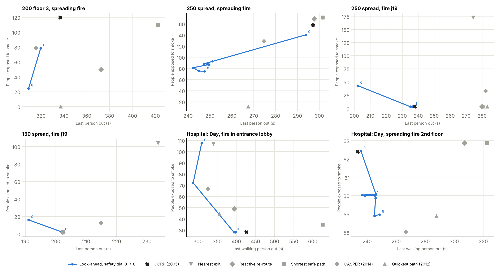

# Safety vs speed: the trade-off made visible (Phase 2)

`config.SAFETY_WEIGHT` is one dial for the capacity planner: 0 = only the hard rule (never walk into fire), 1 = default, 8 = avoid smoke at almost any time cost. Sweeping it gives a curve of (time, people exposed). Other methods are single points from the main experiments (same 30 seeds). Generated by `python -m evac.safety_tradeoff`.

## Findings

1. **200 floor 3, spreading fire**: dial 0 -> 320 s / 78.4 exposed; default (1) -> 309 s / 24.5; dial 8 -> 309 s / 24.5.
2. **250 spread, spreading fire**: dial 0 -> 294 s / 140.2 exposed; default (1) -> 250 s / 87.0; dial 8 -> 248 s / 74.9.
3. **250 spread, fire j19**: dial 0 -> 202 s / 42.8 exposed; default (1) -> 237 s / 2.7; dial 8 -> 237 s / 2.7.
4. **150 spread, fire j19**: dial 0 -> 191 s / 16.1 exposed; default (1) -> 202 s / 1.9; dial 8 -> 202 s / 1.9.
5. **Hospital: Day, fire in entrance lobby**: dial 0 -> 310 s / 107.5 exposed; default (1) -> 396 s / 28.0; dial 8 -> 396 s / 28.0.
6. **Hospital: Day, spreading fire 2nd floor**: dial 0 -> 236 s / 62.4 exposed; default (1) -> 245 s / 60.0; dial 8 -> 249 s / 59.0.
7. **Dominated methods** (some dial setting of look-ahead is at least as fast, within 1%, AND at least as safe): 31 of 36 method-scenario points. CASPER (2014) in 4 of 6 scenarios; CCRP (2005) in 6 of 6 scenarios; Nearest exit in 6 of 6 scenarios; Quickest path (2012) in 3 of 6 scenarios; Reactive re-route in 6 of 6 scenarios; Shortest safe path in 6 of 6 scenarios.
8. **Where look-ahead is NOT the safest at any setting:** Quickest path (2012) in 250 spread, spreading fire (268 s / 11 exposed vs best look-ahead 75); Quickest path (2012) in 200 floor 3, spreading fire (337 s / 0 exposed vs best look-ahead 25); CASPER (2014) in Hospital: Day, spreading fire 2nd floor (267 s / 58 exposed vs best look-ahead 59). Likely reason: quickest path re-decides for each person at every junction with the latest smoke, while look-ahead plans every 5 s as if the fire stayed where it is now. This is the gap the fire-forecast planner (Phase 3) targets.
9. Reading it: a method's single number hides where it sits on this curve. Reporting time alone rewards walking people through smoke (e.g. nearest exit); reporting the curve lets a fire engineer pick the trade-off on purpose.

## The curve (mean of 30 seeds)

| Scenario | dial 0 | dial 0.1 | dial 0.25 | dial 0.5 | dial 1 | dial 2 | dial 4 | dial 8 |
| --- | --- | --- | --- | --- | --- | --- | --- | --- |
| 200 floor 3, spreading fire | 320 s / 78 | 309 s / 25 | 309 s / 25 | 309 s / 25 | 309 s / 25 | 309 s / 25 | 309 s / 25 | 309 s / 25 |
| 250 spread, spreading fire | 294 s / 140 | 247 s / 88 | 249 s / 88 | 249 s / 88 | 250 s / 87 | 242 s / 81 | 245 s / 75 | 248 s / 75 |
| 250 spread, fire j19 | 202 s / 43 | 235 s / 3 | 236 s / 3 | 237 s / 3 | 237 s / 3 | 237 s / 3 | 237 s / 3 | 237 s / 3 |
| 150 spread, fire j19 | 191 s / 16 | 202 s / 2 | 202 s / 2 | 202 s / 2 | 202 s / 2 | 202 s / 2 | 202 s / 2 | 202 s / 2 |
| Hospital: Day, fire in entrance lobby | 310 s / 108 | 287 s / 72 | 394 s / 28 | 394 s / 28 | 396 s / 28 | 398 s / 28 | 398 s / 28 | 396 s / 28 |
| Hospital: Day, spreading fire 2nd floor | 236 s / 62 | 246 s / 60 | 237 s / 60 | 238 s / 60 | 245 s / 60 | 246 s / 60 | 245 s / 59 | 249 s / 59 |

Each cell: time / people exposed. Campus = last person out; hospital = last walking person out.

## Other methods (same seeds)

| Scenario | Nearest exit | Shortest safe path | Reactive re-route | Quickest path (2012) | CASPER (2014) | CCRP (2005) |
| --- | --- | --- | --- | --- | --- | --- |
| 200 floor 3, spreading fire | 422 s / 109 | 422 s / 109 | 373 s / 50 | 337 s / 0 | 316 s / 79 | 337 s / 120 |
| 250 spread, spreading fire | 302 s / 171 | 302 s / 171 | 298 s / 169 | 268 s / 11 | 275 s / 128 | 297 s / 158 |
| 250 spread, fire j19 | 274 s / 173 | 280 s / 3 | 280 s / 3 | 283 s / 3 | 282 s / 32 | 238 s / 3 |
| 150 spread, fire j19 | 234 s / 104 | 202 s / 2 | 202 s / 2 | 202 s / 2 | 215 s / 12 | 202 s / 2 |
| Hospital: Day, fire in entrance lobby | 340 s / 107 | 626 s / 35 | 395 s / 49 | 356 s / 44 | 327 s / 67 | 426 s / 28 |
| Hospital: Day, spreading fire 2nd floor | 323 s / 63 | 323 s / 63 | 307 s / 63 | 288 s / 59 | 267 s / 58 | 234 s / 62 |

How the dial works: the planner's cost of walking an edge is walking time x (1 + w x (smoke multiplier - 1)) + w x 300 s if the edge is smoky (hazard >= 0.3). Edges on fire (hazard >= 0.92) are never used, whatever w. Exposure = people who crossed an edge with hazard >= 0.3 (plus people defending in place reached by smoke).
