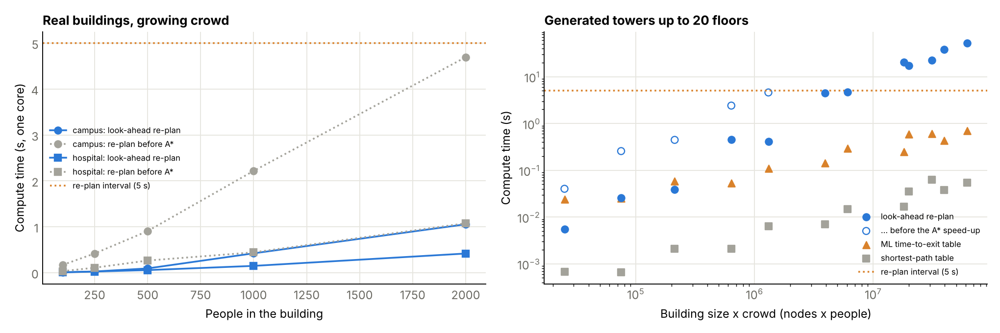

# Scalability: fast enough to run live? (Phase 2)

One look-ahead re-plan has to finish inside the 5 s re-plan interval. Times are on ONE core of the machine this was run on (median of 3, one run for the full re-plan), with everyone still inside and standing (the worst case). Generated by `python -m evac.scalability`.

## Findings

1. **Campus (452 nodes)**: a full re-plan takes 0.03 s for 250 people and 1.06 s for 2,000 people; one-shot CCRP 1.43 s for 2,000.
2. **Largest case inside the 5 s budget**: tower 8 floors x 10x10 (1,636 nodes, 2,400 people) re-planned in 4.50 s.
3. **Over budget**: tower 12 floors x 12x12 with 5,184 people (20.2 s); tower 16 floors x 14x14 with 3,136 people (17.3 s); tower 16 floors x 14x14 with 6,272 people (38.4 s); tower 20 floors x 14x14 with 3,920 people (22.4 s); tower 20 floors x 14x14 with 7,840 people (52.0 s). Remedies, in order of effort: re-plan only the floors that changed, re-plan less often when the fire is not growing (the data-freshness study in docs/final_results.md found 80 s enough there, but ~5 s with a growing fire), or plan floor by floor as two-stage methods do (Wong & Lee 2023).
4. **Growth**: re-plan time grows roughly as nodes^0.68 x people^1.70 (fit on the generated towers) - each person is one time-dependent shortest-path search over the building.
5. **Speed-up made in this step**: the planner's route search is now an A* search with a free-flow lower bound plus cached edge costs (`planner._Fast`). It gives exactly the same evacuation results as before (checked: identical last-out times and exposure on 12 paired runs and in `tests/test_evac_phase2.py`) and is 2.6-15.4x faster (median 5.3x) where both were timed; whole simulations run 3-5x faster.
6. The shortest-path table and the ML time-to-exit table (what signs and the dashboard route use) take at most 0.06 s and 0.70 s even in the largest tower.

| Building | Nodes | People | Look-ahead re-plan (s) | ... before the A* speed-up (s) | One-shot CCRP (s) | Shortest-path table (s) | ML time-to-exit table (s) |
| --- | --- | --- | --- | --- | --- | --- | --- |
| campus | 452 | 100 | 0.01 | 0.17 | 0.01 | 0.001 | 0.057 |
| campus | 452 | 250 | 0.03 | 0.42 | 0.02 | 0.001 | 0.064 |
| campus | 452 | 500 | 0.09 | 0.91 | 0.10 | 0.001 | 0.060 |
| campus | 452 | 1,000 | 0.42 | 2.22 | 0.45 | 0.001 | 0.086 |
| campus | 452 | 2,000 | 1.06 | 4.70 | 1.43 | 0.002 | 0.054 |
| hospital | 124 | 100 | 0.01 | 0.03 | 0.00 | 0.000 | 0.020 |
| hospital | 124 | 250 | 0.03 | 0.11 | 0.02 | 0.000 | 0.020 |
| hospital | 124 | 500 | 0.06 | 0.27 | 0.04 | 0.000 | 0.020 |
| hospital | 124 | 1,000 | 0.15 | 0.44 | 0.11 | 0.000 | 0.022 |
| hospital | 124 | 2,000 | 0.42 | 1.08 | 0.29 | 0.000 | 0.023 |
| tower 3 floors x 6x6 | 232 | 108 | 0.01 | 0.04 | 0.00 | 0.001 | 0.024 |
| tower 3 floors x 6x6 | 232 | 324 | 0.03 | 0.26 | 0.02 | 0.001 | 0.025 |
| tower 5 floors x 8x8 | 664 | 320 | 0.04 | 0.45 | 0.03 | 0.002 | 0.058 |
| tower 5 floors x 8x8 | 664 | 960 | 0.46 | 2.41 | 0.48 | 0.002 | 0.053 |
| tower 8 floors x 10x10 | 1,636 | 800 | 0.41 | 4.61 | 0.54 | 0.006 | 0.109 |
| tower 8 floors x 10x10 | 1,636 | 2,400 | 4.50 | - | 5.33 | 0.007 | 0.142 |
| tower 12 floors x 12x12 | 3,508 | 1,728 | 4.66 | - | 6.78 | 0.015 | 0.293 |
| tower 12 floors x 12x12 | 3,508 | 5,184 | 20.25 | - | 41.43 | 0.017 | 0.245 |
| tower 16 floors x 14x14 | 6,340 | 3,136 | 17.30 | - | 38.57 | 0.035 | 0.587 |
| tower 16 floors x 14x14 | 6,340 | 6,272 | 38.45 | - | 118.09 | 0.038 | 0.435 |
| tower 20 floors x 14x14 | 7,924 | 3,920 | 22.40 | - | 71.90 | 0.063 | 0.612 |
| tower 20 floors x 14x14 | 7,924 | 7,840 | 52.05 | - | 202.35 | 0.055 | 0.704 |

Pure Python on one core; the planner is not parallelised or compiled, so these are upper bounds.
