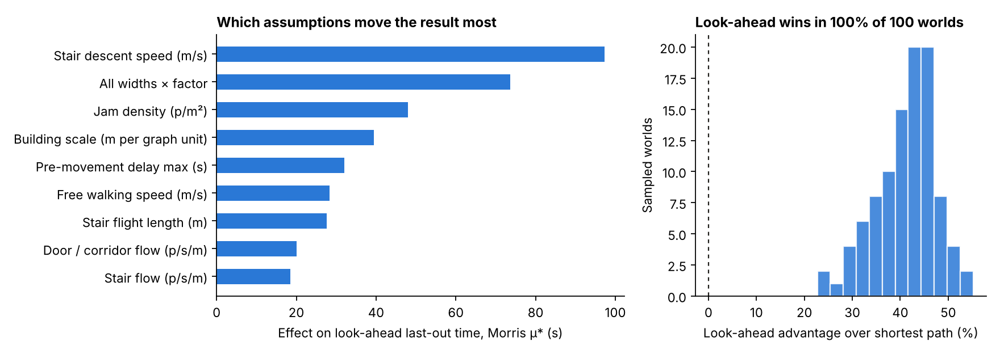

# Sensitivity analysis: do the conclusions survive different assumptions?

Scenario `floor3_full_200`. Morris elementary-effects design (SALib), 10 trajectories x 10 points = 100 sampled 'worlds', all 9 assumptions varied together.

| Assumption | Range | μ* on shortest-path time (s) | μ* on look-ahead time (s) | μ* on advantage (pp) |
| --- | --- | --- | --- | --- |
| Building scale (m per graph unit) | 0.03-0.05 | 46.6 | 39.4 | 6.9 |
| Free walking speed (m/s) | 1.0-1.5 | 43.0 | 28.3 | 9.0 |
| Stair descent speed (m/s) | 0.5-0.8 | 157.6 | 97.3 | 12.9 |
| Door / corridor flow (p/s/m) | 1.0-1.6 | 29.9 | 20.1 | 6.6 |
| Stair flow (p/s/m) | 0.8-1.3 | 45.2 | 18.5 | 6.3 |
| Jam density (p/m²) | 4.5-6.0 | 49.0 | 48.0 | 13.6 |
| All widths × factor | 0.8-1.2 | 82.4 | 73.6 | 9.0 |
| Stair flight length (m) | 6.0-10.0 | 35.2 | 27.7 | 9.6 |
| Pre-movement delay max (s) | 10.0-60.0 | 34.0 | 32.1 | 12.4 |

- Look-ahead beat shortest safe path in **100%** of the 100 worlds.
- Its advantage ranged from 23% to 55% (median 42%).
- Last-out time ranged 270-590 s (shortest path) and 160-348 s (look-ahead).
- Absolute times depend strongly on the assumptions (so they are not predictions of real evacuation times); the *ranking* of methods does not.

