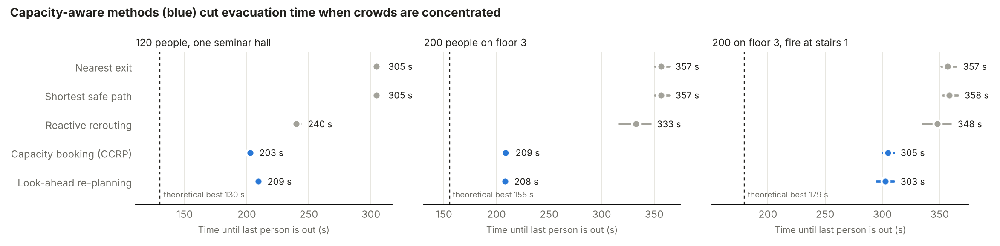
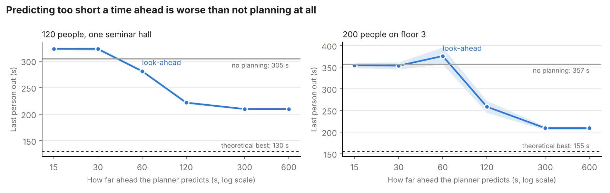
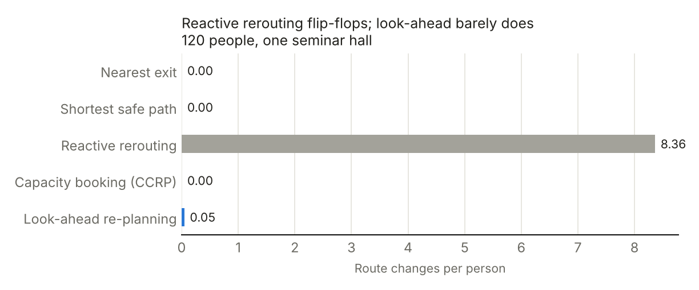

# Session 3 results (preliminary)

10 paired seeds per scenario and method (theoretical best: 3 seeds). Raw data: `results/session3_*.csv`
(regenerate with the commands in `evac/README.md`). Full tables with 95% CIs: `results/session3_all_summary.md`.

## Last person out (mean seconds)

| Scenario | Shortest safe path | Reactive | Capacity booking (CCRP) | Look-ahead | Theoretical best | CCRP vs shortest | Share of possible gain captured |
| --- | --- | --- | --- | --- | --- | --- | --- |
| lecture_hall_f1_120 | 305 | 240 | 203 | 209 | 130 | -33% | 58% |
| floor3_full_200 | 357 | 333 | 209 | 208 | 155 | -41% | 73% |
| floor3_full_200_fire_stairs1 | 358 | 348 | 305 | 303 | 179 | -15% | 30% |
| crowd_250_fire_j19 | 271 | 275 | 247 | 246 | 162 | -9% | 22% |
| fire_j19_150 | 210 | 210 | 210 | 210 | 163 | -0% | 0% |
| fire_j6_east_exit_150 | 216 | 216 | 214 | 214 | 175 | -1% | 6% |
| baseline_150_no_fire | 196 | 196 | 192 | 192 | 163 | -2% | 12% |

"Share of possible gain captured" = (shortest - CCRP) / (shortest - theoretical best).

## Findings

1. **Capacity booking cuts last-out time by 33-41% when crowds are concentrated** (a full seminar hall, a full floor),
   capturing 58-73% of the gap to the theoretical best, with zero route changes. With a fire blocking the main stair
   shaft the gain drops to 15%, and with a large crowd spread over the building to 9%.
2. **When people are spread across all 7 floors, every method ties** (within about 5%). Coordination only pays
   once a stair or door is overloaded - this is the "tipping point" to quantify in Session 6.
3. **Reactive rerouting oscillates:** ~8.4 route changes per person in the seminar-hall case (1,003 for 120 people),
   and it still loses to capacity booking by ~37 s. Look-ahead re-planning changes 0.05 routes per person.
4. **Prediction horizon is critical.** Look-ahead with a 15-60 s horizon was *worse* than no planning (e.g. 375 s vs
   357 s on floor 3, 60 s horizon); 300 s or more matches capacity booking. Short horizons hide the queues that
   later people will cause.
5. **Safety is not traded for speed.** The planner exposes the same number of people to hazard as shortest safe path
   (a 300 s penalty per exposed edge stops it detouring through smoke to avoid queues).
6. **Stairs are the real bottleneck.** Under the speed-density model a 1.2 m stair sustains ~0.7 persons/s - half its
   nominal flow. A planner using nominal capacity overbooked stairs and only moved the queue.
7. With perfect compliance, re-planning (look-ahead) adds nothing over a one-shot plan. Its value should appear when
   people deviate or the fire changes - Session 4 tests exactly that.

## Caveats
- All physical values are assumptions (`evac/config.py`); the planner assumes it knows each person's start time.
- The theoretical best relaxes the model (fractional flow, free speed), so the true achievable optimum is somewhat higher.
