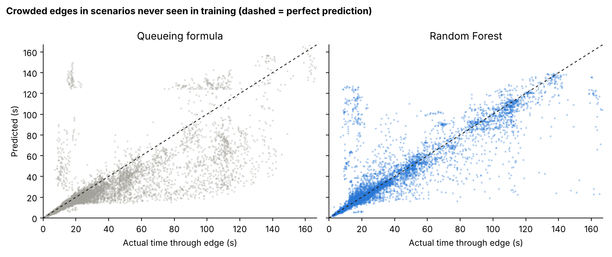

# Session 4 results (preliminary)

Small runs (3 paired seeds) to check direction; the full statistics come in Session 6.

## 1. When people don't follow guidance (200 people on floor 3)

Non-compliant people head for the exit they know (north main entrance); "herding" people
copy the majority exit of the queue they join. Values are swept, not claimed as measured behaviour.

| Compliance | Shortest safe path | Reactive | One-shot capacity booking | Look-ahead re-planning |
| --- | --- | --- | --- | --- |
| 100% | 354 s | 310 s | 212 s | 210 s |
| 80% | 411 s | 320 s | 329 s | **293 s** |
| 60% | 411 s | 341 s | 374 s | **305 s** |
| 40% | 412 s | 371 s | 416 s | **361 s** |

- A one-shot plan collapses once people deviate (its bookings no longer match reality); at 40% compliance
  it is no better than no plan at all.
- Look-ahead re-planning re-books capacity from what people actually do and stays best at every level.
  **This is where re-planning earns its place** - with perfect compliance it added nothing.
- Herding (60% of non-compliant people copying the crowd) changed results by < 2% here.

## 2. Fire that spreads (fire starts small at stairs 1, grows 0.5 m/s; smoke climbs 30 s per floor)

| Method | Last out | People exposed to smoke/fire |
| --- | --- | --- |
| Shortest safe path (plans once at the alarm) | 354 s | 106-114 |
| One-shot capacity booking | 292 s | 124-127 |
| Reactive rerouting | 340 s | 39-47 |
| **Look-ahead re-planning** | 305 s | **32-49** |

Plans made once at the alarm cannot see the fire grow. Re-planning cut exposure by roughly 60-70% while
staying faster than shortest-path and reactive routing. The fastest method (one-shot booking) was also the
most dangerous - speed and safety must be reported together.

## 3. Does ML earn its place?

See `ml_delay_results.md`. A Random Forest trained on simulator data to predict real edge delay beats a
textbook queueing formula on crowded edges in unseen scenarios (MAE 5.3 s vs 9.1 s, R² 0.79 vs 0.59) and
at unseen fire locations (MAE 4.9 s vs 8.3 s). A random-row split overstates accuracy (R² 0.92 vs 0.79).
The old edge-cost model, which only re-learned a hand-written formula, should be retired.

