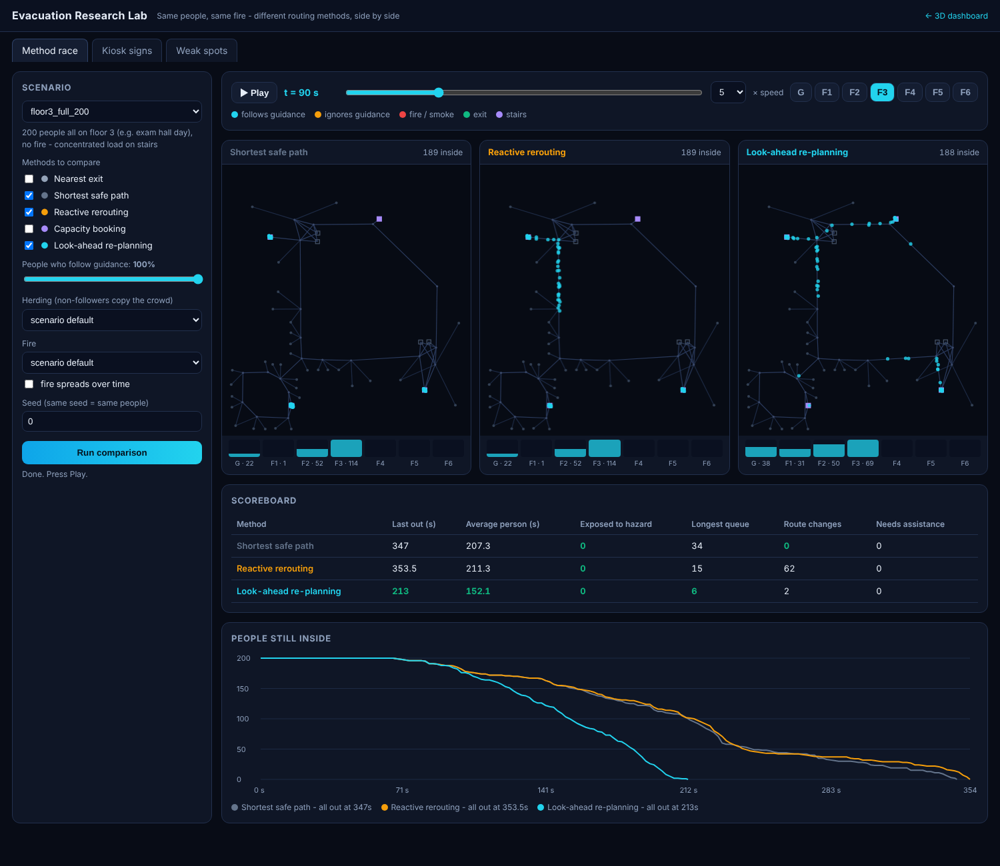
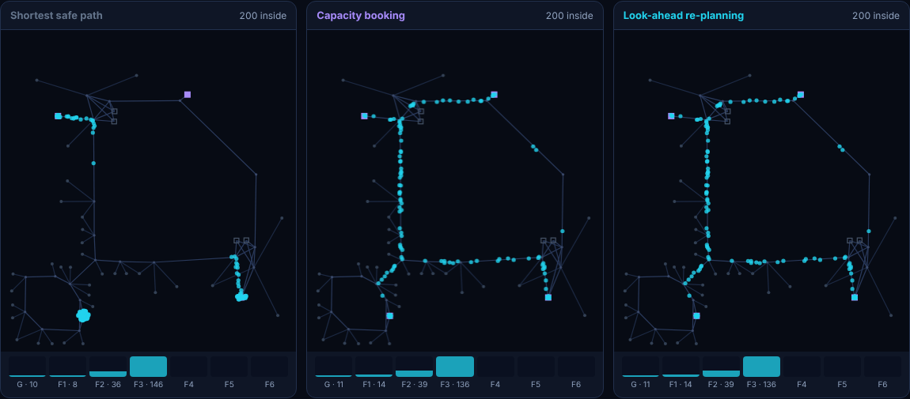
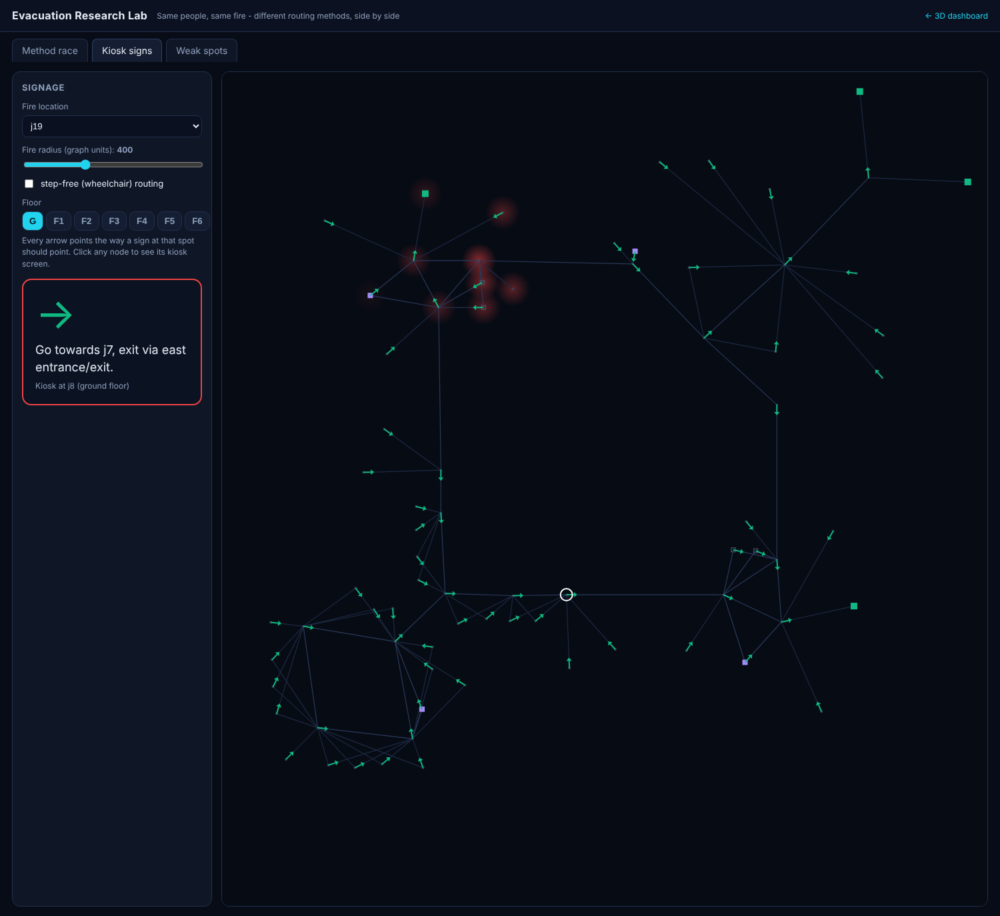

# Session 5: research dashboard, kiosk signs, weak spots

Run `python research_server.py`, then open `http://localhost:8000/research`. The original 3D dashboard is unchanged at `/`.
`server.py` and `index.html` were not modified; the new pieces live in `research_server.py`, `research.html` and `evac/api.py`.

## Method race
The same people and the same fire, simulated under each selected method, replayed side by side per floor.
People in a queue are drawn as a blob, so a jam is visible. Below the panels: scoreboard (best value in green)
and a "people still inside" curve.

With shortest safe path, 200 people from floor 3 pile up at one stairwell; the capacity-aware methods spread them
over several stairwells from the start:

## Kiosk signs
One multi-source Dijkstra from the exits gives every node its next step, so every sign in the building gets its
arrow in a single pass (recomputed when the fire changes, step-free option). Clicking a spot shows the kiosk screen
for that location, for example "Go towards f3_j3, take stairs 3 down, exit via east entrance/exit."

## Weak spots (`docs/weakspots.md`)
Blocking whole stairwells, exit doors and key corridors one at a time (200 people on floor 3, capacity booking):

| Rank | Blocked element | Last person out | Average person |
| --- | --- | --- | --- |
| 1 | Stairwell 1 | +88 s | +45 s |
| 2 | Stairwell 3 | +86 s | +49 s |
| 3 | North exit door | +53 s | +28 s |
| 4 | Stairwell 4 | +45 s | +18 s |

Stairwells 1 and 3 are the building's critical elements for upper-floor evacuation: these are where smoke control,
wider stairs or a fire warden would matter most.
