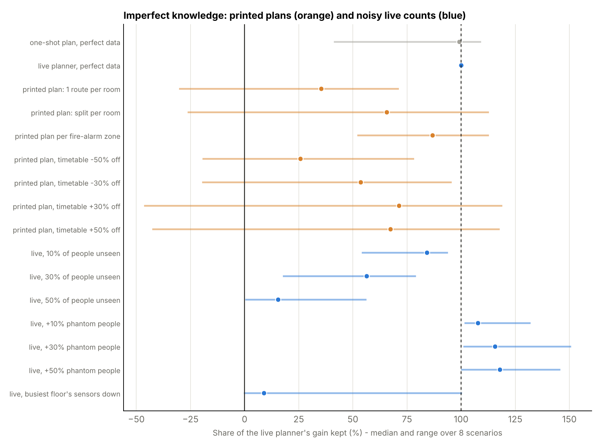
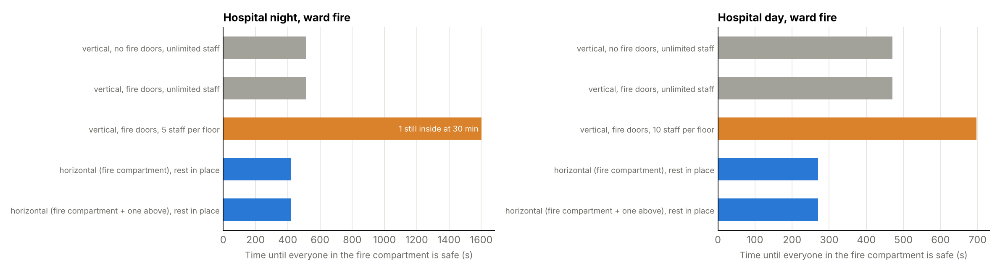
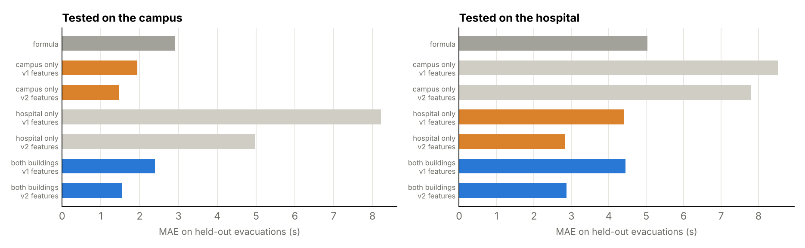

# Session 7: making it practical

Three questions a building manager would ask: *Do I need sensors? What if they are wrong? And in a hospital, should we evacuate at all?* Same engine and statistics as before.

## Key findings

1. **No IoT needed for most of the gain - when there is no fire in the way.** A plan printed once from the expected occupancy (rooms split between stairwells) keeps a median **91%** of the live planner's gain in the scenarios without a fire on the escape routes, but only 0% in the fire scenarios: a printed plan cannot know where the fire is. One route per room keeps just 35% overall.
2. Fix without crowd sensors: pre-compute one plan **per fire-alarm zone** (the fire panel already knows where the alarm is) - it keeps 82% of the gain in the fire scenarios.
3. The printed plan is robust to a wrong timetable: with 30-50% fewer or more people than expected it still keeps 26%-71% of the gain.
4. With live but imperfect counts, **missing people hurt far more than phantom ones**: 10/30/50% unseen keeps 84%/56%/15% of the gain, while +10/30/50% phantoms keep 108%/116%/118% - over 100%, i.e. planning for more people than seen is even slightly BETTER than exact counts (it acts as a safety margin on stair capacity). Design rule: over-count rather than under-count. With the busiest floor's sensors down: 9%.
5. **Fire doors matter most:** in the night ward fire they cut the people exposed from 64 to 30 - routing could not do that.
6. **Staff, not routing, limits a vertical hospital evacuation.** With 5 night staff per ward floor (2 per bed), evacuating everyone down the ramp takes 1711 s and 15.1 people are still inside after 30 minutes (unlimited staff: 569 s).
7. **Progressive horizontal evacuation** (the standard hospital procedure) gets everyone in the fire compartment to safety in 421 s with the same staff, no one left behind, and no more people exposed (30 vs 29). The model reproduces why hospitals move patients sideways first.
8. ML: Campus-trained model on the hospital: MAE 8.52 s (formula 5.03 s) - worse than the formula; on slow movers 10.4 s vs 5.8 s.
9. ML: Trained on BOTH buildings with mover speed/size and ramp features (v2): hospital MAE 2.87 s (slow movers 3.2 s) - now better than the formula - and campus accuracy does not suffer (1.55 s vs 1.94 s for the campus-only model).
10. ML: In the planner, vs the formula: hospital v1 +8.1% -> v2 +2.9%; campus v1 +1.9% -> v2 -0.5%. Retraining shrinks the transfer penalty from +8.1% to +2.9%, but the plain formula is still as good inside the planner: a more accurate predictor does not make the plan much better - coordination does. Lesson: a learned component must be retrained for each new kind of building, the formula needs no training.

## 1. What if the system does not know exactly where people are?

Metric: last person out (campus) / last WALKING person out (hospital), mean of 10 seeds. **Gain kept** = share of the live planner's improvement over shortest path that a variant keeps (100% = as good as perfect live data, 0% = no better than shortest path). Same people in every row.

| Variant | Campus: 200 on floor 3 | Campus: 120 in one hall | Campus: 60% comply + herding | Hospital: day peak | Hospital: fire at stairs 1 (2nd) | Hospital: 70% comply | Campus: fire at stairs 1 | Campus: spreading fire | Gain kept (median) |
| --- | --- | --- | --- | --- | --- | --- | --- | --- | --- |
| shortest path (no plan) | 357 | 305 | 409 | 360 | 403 | 336 | 358 | 357 | 0% |
| one-shot plan, perfect data | 209 | 203 | 363 | 220 | 281 | 266 | 305 | 289 | 99% |
| live planner, perfect data | 208 | 209 | 299 | 219 | 280 | 249 | 303 | 294 | 100% |
| printed plan: 1 route per room | 299 | 305 | 367 | 304 | 403 | 274 | 375 | 337 | 35% |
| printed plan: split per room | 240 | 198 | 351 | 231 | 403 | 247 | 373 | 343 | 66% |
| printed plan per fire-alarm zone | 240 | 198 | 351 | 231 | 282 | 247 | 316 | 305 | 87% |
| printed plan, timetable -50% off | 303 | 230 | 367 | 338 | 403 | 302 | 369 | 360 | 26% |
| printed plan, timetable -30% off | 260 | 214 | 356 | 277 | 403 | 264 | 369 | 345 | 54% |
| printed plan, timetable +30% off | 219 | 192 | 354 | 215 | 393 | 234 | 384 | 332 | 71% |
| printed plan, timetable +50% off | 224 | 193 | 359 | 233 | 384 | 239 | 382 | 341 | 67% |
| live, 10% of people unseen | 237 | 217 | 310 | 229 | 304 | 259 | 321 | 323 | 84% |
| live, 30% of people unseen | 266 | 230 | 329 | 287 | 378 | 282 | 343 | 346 | 56% |
| live, 50% of people unseen | 295 | 251 | 355 | 352 | 402 | 317 | 353 | 354 | 15% |
| live, +10% phantom people | 205 | 205 | 287 | 210 | 269 | 245 | 291 | 274 | 108% |
| live, +30% phantom people | 206 | 186 | 288 | 207 | 260 | 236 | 293 | 262 | 116% |
| live, +50% phantom people | 207 | 183 | 286 | 209 | 261 | 231 | 286 | 266 | 118% |
| live, busiest floor's sensors down | 349 | 305 | 400 | 219 | 280 | 249 | 353 | 355 | 9% |

People exposed to smoke, mean over the fire scenarios: shortest path (no plan) 35.8; one-shot plan, perfect data 42.0; live planner, perfect data 13.3; printed plan: 1 route per room 37.5; printed plan: split per room 39.2; printed plan per fire-alarm zone 41.2; printed plan, timetable -50% off 31.2; printed plan, timetable -30% off 36.3; printed plan, timetable +30% off 39.1; printed plan, timetable +50% off 39.9; live, 10% of people unseen 11.4; live, 30% of people unseen 10.4; live, 50% of people unseen 11.7; live, +10% phantom people 15.4; live, +30% phantom people 18.7; live, +50% phantom people 20.7; live, busiest floor's sensors down 30.2.

Printed plans for three scenarios: `docs/plans/` (room -> stairs -> exit, with the share of the room).

## 2. Hospital: evacuate everyone, or move patients sideways first?

Fire starts in the 2nd-floor store room (west compartment). 'Fire doors' = the fire is contained in its compartment (other compartment gets only light smoke). Staff: 2 per bed, they walk back for the next bed. Horizontal = everyone in the fire compartment goes to the east compartment of the same floor; everyone else stays where they are (defend in place). 10 seeds.

| Scenario | Fire spread | Strategy | Fire compartment safe (s) | Everyone safe / out (s) | Still inside at 30 min | Exposed | Defending in place |
| --- | --- | --- | --- | --- | --- | --- | --- |
| Hospital night, ward fire | spread 0.1 m/s | A. vertical, no fire doors, unlimited staff | 512 | 569 | 0.0 | 41.7 | 0 |
| Hospital night, ward fire | spread 0.1 m/s | B. vertical, fire doors, unlimited staff | 512 | 569 | 0.0 | 13.0 | 0 |
| Hospital night, ward fire | spread 0.1 m/s | C. vertical, fire doors, 5 staff per floor | 1603 (1.0 still inside at 30 min) | 1711 | 15.1 | 12.5 | 0 |
| Hospital night, ward fire | spread 0.1 m/s | D. horizontal (fire compartment), rest in place | 421 | 421 | 0.0 | 12.8 | 59 |
| Hospital night, ward fire | spread 0.1 m/s | E. horizontal (fire compartment + one above), rest in place | 421 | 597 | 0.0 | 12.8 | 28 |
| Hospital night, ward fire | spread 0.5 m/s | A. vertical, no fire doors, unlimited staff | 512 | 569 | 0.0 | 64.1 | 0 |
| Hospital night, ward fire | spread 0.5 m/s | B. vertical, fire doors, unlimited staff | 512 | 569 | 0.0 | 29.6 | 0 |
| Hospital night, ward fire | spread 0.5 m/s | C. vertical, fire doors, 5 staff per floor | 1603 (1.0 still inside at 30 min) | 1711 | 15.1 | 29.3 | 0 |
| Hospital night, ward fire | spread 0.5 m/s | D. horizontal (fire compartment), rest in place | 421 | 421 | 0.0 | 29.6 | 59 |
| Hospital night, ward fire | spread 0.5 m/s | E. horizontal (fire compartment + one above), rest in place | 421 | 597 | 0.0 | 29.6 | 28 |
| Hospital day, ward fire | spread 0.1 m/s | A. vertical, no fire doors, unlimited staff | 470; 2.3 cut off by the fire from the start | 565 | 0.0 | 34.0 | 0 |
| Hospital day, ward fire | spread 0.1 m/s | B. vertical, fire doors, unlimited staff | 470; 2.3 cut off by the fire from the start | 565 | 0.0 | 12.9 | 0 |
| Hospital day, ward fire | spread 0.1 m/s | C. vertical, fire doors, 10 staff per floor | 697; 2.3 cut off by the fire from the start | 1323 | 0.0 | 12.9 | 0 |
| Hospital day, ward fire | spread 0.1 m/s | D. horizontal (fire compartment), rest in place | 270; 2.3 cut off by the fire from the start | 270 | 0.0 | 12.9 | 271 |
| Hospital day, ward fire | spread 0.1 m/s | E. horizontal (fire compartment + one above), rest in place | 270; 2.3 cut off by the fire from the start | 304 | 0.0 | 12.9 | 232 |
| Hospital day, ward fire | spread 0.5 m/s | A. vertical, no fire doors, unlimited staff | 470; 2.3 cut off by the fire from the start | 565 | 0.0 | 61.8 | 0 |
| Hospital day, ward fire | spread 0.5 m/s | B. vertical, fire doors, unlimited staff | 470; 2.3 cut off by the fire from the start | 565 | 0.0 | 32.5 | 0 |
| Hospital day, ward fire | spread 0.5 m/s | C. vertical, fire doors, 10 staff per floor | 697; 2.3 cut off by the fire from the start | 1323 | 0.0 | 32.5 | 0 |
| Hospital day, ward fire | spread 0.5 m/s | D. horizontal (fire compartment), rest in place | 270; 2.3 cut off by the fire from the start | 270 | 0.0 | 32.5 | 271 |
| Hospital day, ward fire | spread 0.5 m/s | E. horizontal (fire compartment + one above), rest in place | 270; 2.3 cut off by the fire from the start | 304 | 0.0 | 32.5 | 232 |

Fire compartment safe = time until everyone there who can move is at an exit or in the refuge (1800 s if anyone is still inside at 30 min). 'Cut off' = people in the room where the fire starts, with no route from the first moment - the same in every strategy.

## 3. Retraining the ML model on both buildings

See [ml_transfer.md](ml_transfer.md).

## Assumptions and limits of these experiments

- Fire compartments are assumed at the bed-lift core (the drawings do not mark fire doors); light smoke through closed fire doors = 15% of the hazard.
- Staff are modelled only as teams of 2 per bed with a fixed walk back; their own risk is not modelled.
- Defend-in-place exposure is checked at the person's room; a real refuge also needs smoke control.
- Sensor errors are random per update; real systems can have correlated errors (a whole camera zone).
- A printed plan is made without knowing the fire; in a fire, routes through smoke fall back to the signs.
