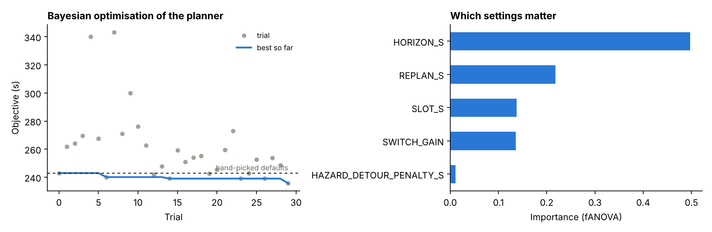

# Automatic tuning of the look-ahead planner (Bayesian optimisation)

Optuna TPE sampler, 30 trials, objective = mean last-out + 300 s per exposed person over 3 training cases x seeds 0-1. Trial 0 = the hand-picked defaults.

| Setting | Hand-picked | Tuned | Importance |
| --- | --- | --- | --- |
| HORIZON_S | 300 | 870 | 0.50 |
| SWITCH_GAIN | 0.15 | 0.00691 | 0.14 |
| REPLAN_S | 5 | 19.8 | 0.22 |
| SLOT_S | 4 | 5.08 | 0.14 |
| HAZARD_DETOUR_PENALTY_S | 300 | 127 | 0.01 |

Best trial #29 scored 235.7 vs defaults 242.9 (-3.0%) on the training cases.

**How to read this.** The training cases have no growing fire. The held-out table below is the real test: the tuned settings are 3% better on the training cases, slightly better at 60% compliance, but on the held-out spreading-fire scenario they expose **92 people instead of 38** and are 10% slower. The tuner chose a 20 s re-plan interval, which is harmless without fire but lets people walk into a growing fire (the same effect as the freshness experiment in final_results.md). This is classic over-fitting to the training cases. We therefore keep the hand-picked defaults for all reported results, and report tuning as evidence of (a) which settings matter (planning horizon most) and (b) why planner settings must be validated on hazard scenarios, not just crowd scenarios.

_Bug found by this experiment: with a non-integer slot length, floating-point rounding (3 x 4.1 = 12.2999...) booked people into the wrong time slot. Fixed in planner.Reservations.slot (regression test in tests/test_evac_session6.py); results with the default 4 s slot were unaffected._

Held-out check (seeds 5-7, never used in tuning). Objective = last-out + 300 s per exposed person; last-out and exposed people shown separately:

| Case | Objective (hand-picked / tuned) | Last-out s (hand / tuned) | Exposed (hand / tuned) | Scenario used in tuning? |
| --- | --- | --- | --- | --- |
| floor3_full_200 | 207.0 / 210.5 | 207.0 / 210.5 | 0.0 / 0.0 | yes (different seeds) |
| lecture_hall_f1_120 | 207.7 / 216.0 | 207.7 / 216.0 | 0.0 / 0.0 | yes (different seeds) |
| floor3_full_200 (60% compliance) | 301.0 / 286.0 | 301.0 / 286.0 | 0.0 / 0.0 | yes (different seeds) |
| floor3_200_spreading_fire_stairs1 | 11788.8 / 27818.7 | 288.8 / 318.7 | 38.3 / 91.7 | no (held out) |
| crowd_250_fire_j19 | 1142.5 / 1145.5 | 242.5 / 245.5 | 3.0 / 3.0 | no (held out) |

_Runtime 238 s._
