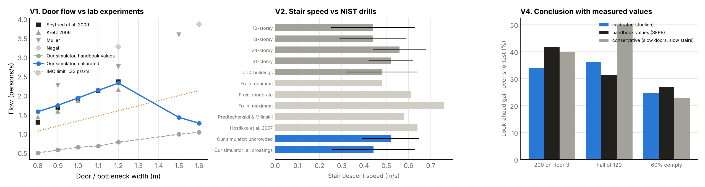

# Validation: how close is the simulator to real people? (Session 8)

Verification (`docs/verification/`) showed the code implements its model. Validation asks whether the model's numbers match real crowds. Every published value below is cited.

## Findings

1. **Door flow now matches laboratory measurements.** Measured where people LEAVE the door, the simulator with handbook values passed only 32%-38% of the flow measured in bottleneck experiments (Seyfried et al. 2009) - crowding on the door edge slowed its own outflow. After calibration on Juelich trajectories (docs/calibration.md) it passes 98%-122%. The handbook set is kept as a conservative option (`PARAM_SET = "sfpe"`).
2. **Stair speed matches real drills.** Across all simulated stair crossings the mean speed is 0.44 +- 0.19 m/s; NIST measured 0.48 +- 0.16 m/s in fire drills in four office buildings (about 3,000 evacuees analysed). Uncrowded, our people descend at 0.52 m/s, inside the handbook range (Fruin 0.48-0.76 m/s).
3. **Standard model tests:** IMO 1 - 40 m corridor, 1 person (handbook values): PASS (33.5 s); IMO 4 - 100 persons through a 1 m door (handbook values): PASS (0.64 persons/s); IMO 9 - 1000 persons, 4 doors vs 2 doors (handbook values): PASS (416.0 s vs 816.5 s (ratio 1.96)); IMO 1 - 40 m corridor, 1 person (calibrated): PASS (31.0 s); IMO 4 - 100 persons through a 1 m door (calibrated): FAIL (1.93 persons/s); IMO 9 - 1000 persons, 4 doors vs 2 doors (calibrated): PASS (144.0 s vs 276.0 s (ratio 1.92)).
4. **The conclusion survives every parameter set.** Look-ahead beats shortest path by 25%-36% with calibrated values (30 of 30 paired runs), 27%-42% with handbook values (30 of 30), and 23%-50% with slow doors and slow stairs (30 of 30).
5. **Field drill ready:** a 3-person stopwatch protocol (`docs/field_validation_protocol.md`) and `python -m evac.validation --drill` turn one timed real exit into a measured-vs-simulated comparison.

## V1. Flow through a door / bottleneck (persons per second)

| Width (m) | Our simulator, handbook | Our simulator, calibrated | Seyfried et al. 2009 | Kretz 2006 | Muller | Nagai | IMO max (1.33 x w) |
| --- | --- | --- | --- | --- | --- | --- | --- |
| 0.8 | 0.49 | 1.57 | 1.29 | 1.43 | - | 2.58 | 1.06 |
| 0.9 | 0.57 | 1.74 | 1.67 | 1.58 | 2.26 | - | 1.20 |
| 1.0 | 0.64 | 1.93 | 1.90 | 1.85 | - | - | 1.33 |
| 1.1 | 0.67 | 2.13 | 2.12 | - | - | - | 1.46 |
| 1.2 | 0.77 | 2.32 | 2.36 | 2.15 | 2.75 | 3.27 | 1.60 |
| 1.5 | 0.98 | 1.42 | - | - | 3.59 | - | 2.00 |
| 1.6 | 1.03 | 1.27 | - | - | - | 3.86 | 2.13 |

Lab values: Seyfried et al. (2009), *New insights into pedestrian flow through bottlenecks*, Transportation Science 43(3):395-406 (Table 2, dN = 60; Table 1 for the other groups). Higher values come from dense, motivated crowds; the 1.3 p/s/m engineering value is deliberately conservative. Simulated flow = steady rate of people leaving the door (10-90 % of the group).

## V2. Stair descent speed (m/s)

| Source | Mean | SD |
| --- | --- | --- |
| NIST drill, 10-storey | 0.44 | 0.19 |
| NIST drill, 18-storey | 0.44 | 0.15 |
| NIST drill, 24-storey | 0.56 | 0.12 |
| NIST drill, 31-storey | 0.52 | 0.1 |
| NIST drill, all 4 buildings | 0.48 | 0.16 |
| Fruin, optimum | 0.48 | - |
| Fruin, moderate | 0.61 | - |
| Fruin, maximum | 0.76 | - |
| Predtechenskii & Milinskii | 0.58 | - |
| Hostikka et al. 2007 | 0.64 | - |
| **Our simulator, uncrowded crossings** | 0.52 | 0.13 |
| **Our simulator, all 5,182 crossings** | 0.44 | 0.19 |

NIST: Peacock, Hoskins & Kuligowski (2012), *Overall and local movement speeds during fire drill evacuations in buildings up to 31 stories*, Safety Science 50:1655-1664, Table 3 (literature values from its Table 1). Simulated speed = flight length / time from joining the stair to leaving it (crowding and stair queues included).

## V3. IMO MSC.1/Circ.1533 verification tests

| Test | Expected | Result | |
| --- | --- | --- | --- |
| IMO 1 - 40 m corridor, 1 person (handbook values) | 32.0 s (40 m / 1.25 m/s) | 33.5 s | PASS |
| IMO 4 - 100 persons through a 1 m door (handbook values) | mean flow <= 1.33 persons/s | 0.64 persons/s | PASS |
| IMO 9 - 1000 persons, 4 doors vs 2 doors (handbook values) | time ratio about 2 | 416.0 s vs 816.5 s (ratio 1.96) | PASS |
| IMO 1 - 40 m corridor, 1 person (calibrated) | 29.1 s (40 m / 1.373 m/s) | 31.0 s | PASS |
| IMO 4 - 100 persons through a 1 m door (calibrated) | mean flow <= 1.33 persons/s | 1.93 persons/s | FAIL |
| IMO 9 - 1000 persons, 4 doors vs 2 doors (calibrated) | time ratio about 2 | 144.0 s vs 276.0 s (ratio 1.92) | PASS |

IMO test 4 is a DESIGN cap for ship-evacuation software (1.33 persons/s/m). The calibrated set reproduces laboratory flows (~1.9 persons/s/m), so it is expected to exceed that cap; the handbook set passes it.

IMO 9 uses the one-shot capacity planner for door choice: in a network model the whole room is one node, so with plain shortest path all 1000 people tie for the same nearest door (917 s whatever the number of doors) - itself a small demonstration of the problem this project solves.

Tests that need 2-D geometry (rounding corners, counter-flow in a corridor) do not apply to a network (graph) model and are listed as a limitation.

## V4. Does the conclusion survive measured values?

| Assumption set | Scenario | Shortest (s) | Look-ahead (s) | Gain | Look-ahead faster in |
| --- | --- | --- | --- | --- | --- |
| calibrated (Juelich) | floor3_full_200 | 359 | 237 | 34% | 10/10 seeds |
| calibrated (Juelich) | lecture_hall_f1_120 | 354 | 226 | 36% | 10/10 seeds |
| calibrated (Juelich) | floor3_200_compliance60_herding | 407 | 307 | 25% | 10/10 seeds |
| handbook values (SFPE) | floor3_full_200 | 357 | 208 | 42% | 10/10 seeds |
| handbook values (SFPE) | lecture_hall_f1_120 | 305 | 209 | 31% | 10/10 seeds |
| handbook values (SFPE) | floor3_200_compliance60_herding | 409 | 299 | 27% | 10/10 seeds |
| conservative (slow doors, slow stairs) | floor3_full_200 | 491 | 296 | 40% | 10/10 seeds |
| conservative (slow doors, slow stairs) | lecture_hall_f1_120 | 455 | 227 | 50% | 10/10 seeds |
| conservative (slow doors, slow stairs) | floor3_200_compliance60_herding | 542 | 418 | 23% | 10/10 seeds |

## V5. Real drill

See `docs/field_validation_protocol.md`. No real drill has been timed yet; when one is, its comparison goes here.
