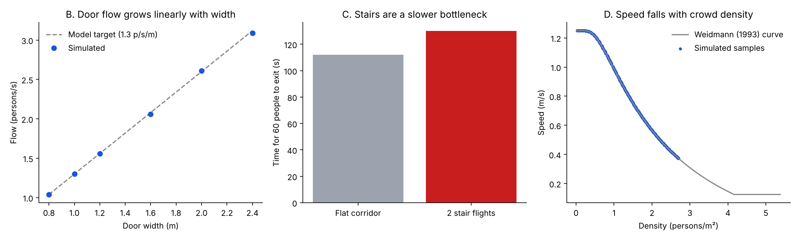

# Simulator verification

Checks that the simulator implements its stated assumptions (see `evac/config.py`).
This is verification, not validation against real evacuations.

| Test | Expected | Measured | Result |
| --- | --- | --- | --- |
| A. Free walking (52 m) | 41.6 s | 43.5 s | PASS |
| B. Door flow, 1.0 m door | 1.3 persons/s | 1.3 persons/s | PASS |
| C. 60 people: 2 stair flights vs flat corridor | stairs slower  | 130.0 s vs 112.0 s  | PASS |
| D. Speed vs density on a crowded corridor | on Weidmann curve  | max deviation 0.001 m/s, peak 2.70 p/m^2  | PASS |

