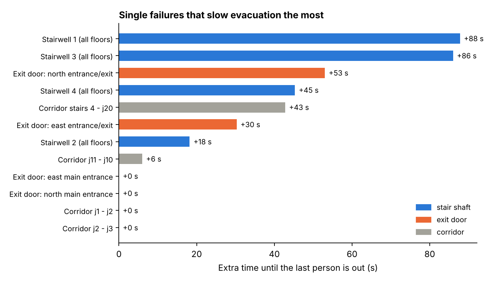

# Weak-spot analysis: `floor3_full_200`, method `ccrp`

Baseline: last person out at 212.2 s (mean 150.6 s). Each row blocks ONE element and re-runs the same evacuation.

| Rank | Blocked element | Last out (+s) | Average person (+s) | People cut off |
| --- | --- | --- | --- | --- |
| 1 | Stairwell 1 (all floors) | +87.8 | +45.4 | 0 |
| 2 | Stairwell 3 (all floors) | +86.0 | +49.4 | 0 |
| 3 | Exit door: north entrance/exit | +53.0 | +28.2 | 0 |
| 4 | Stairwell 4 (all floors) | +45.3 | +17.6 | 0 |
| 5 | Corridor stairs 4 - j20 | +42.8 | +15.0 | 0 |
| 6 | Exit door: east entrance/exit | +30.3 | +18.2 | 0 |
| 7 | Stairwell 2 (all floors) | +18.2 | +10.0 | 0 |
| 8 | Corridor j11 - j10 | +6.0 | +8.2 | 0 |
| 9 | Exit door: east main entrance | +0.0 | +0.0 | 0 |
| 10 | Exit door: north main entrance | +0.0 | +0.0 | 0 |
| 11 | Corridor j1 - j2 | +0.0 | +0.0 | 0 |
| 12 | Corridor j2 - j3 | +0.0 | +0.0 | 0 |
| 13 | Corridor j3 - j4 | +0.0 | +0.0 | 0 |
| 14 | Corridor j5 - j4 | +0.0 | +0.0 | 0 |
| 15 | Corridor j20 - j3 | +0.0 | +0.0 | 0 |
| 16 | Corridor j7 - j8 | -0.2 | +0.0 | 0 |
| 17 | Corridor j8 - j9 | -0.2 | +0.0 | 0 |
| 18 | Corridor j9 - j10 | -0.2 | +0.0 | 0 |
| 19 | Corridor stairs 3 - j6 | -1.8 | +1.6 | 0 |
| 20 | Corridor stairs 2 - j11 | -5.7 | -0.6 | 0 |

People cut off = no remaining route to any exit, newly needing assistance, or still inside at the 30-minute cap.

